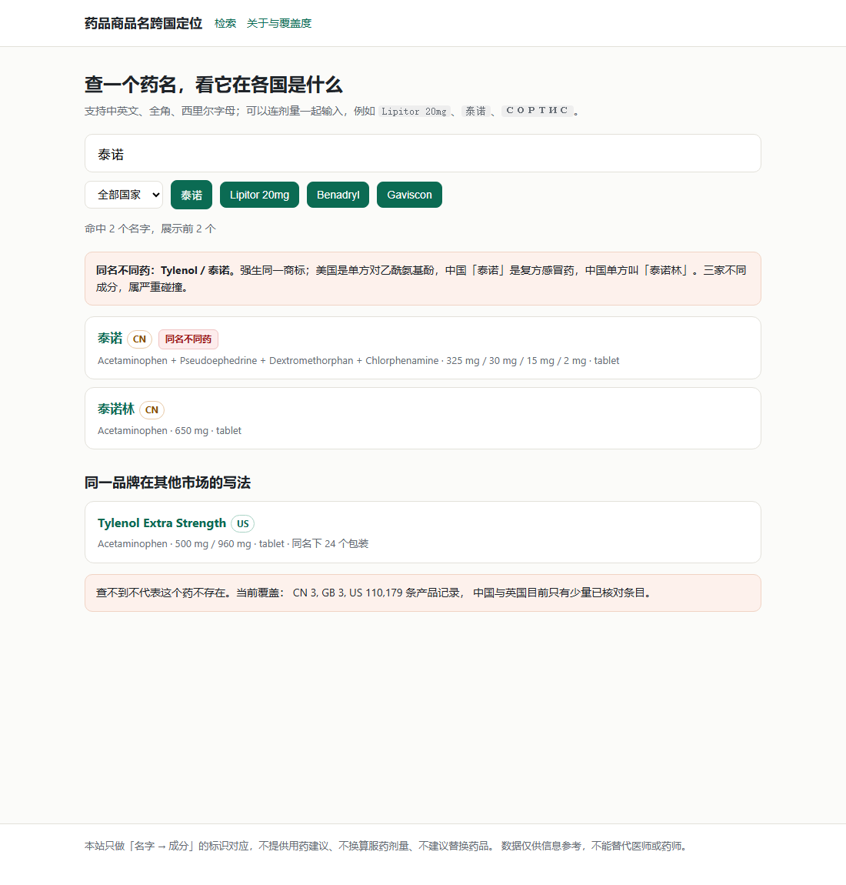

# 药品商品名跨国定位站

给一个名字（或包装上的一行字），定位到它是哪个药、什么规格，再给出其他国家的对应产品。

**范围**：公开上线 · 美国 / 英国 / 西班牙 / 墨西哥 / 中国 / 澳洲 · 只用可公开许可（或官方明确允许再发布）的数据源。
**当前状态**：六个市场全部入库，站点静态生成。美国、英国、中国是全量；西班牙、墨西哥、澳洲各有各的缺口，页面上如实标注。



## 现在已经能做什么

| 能力 | 状态 |
|---|---|
| 美国 110,179 个产品入库（openFDA NDC） | ✅ |
| 英国 61,051 个产品入库（dm+d 全量，129,266 条 AMP → 过滤器械后） | ✅ |
| 中国 135,351 个产品入库（医保药品分类与代码库，化学药；中成药未收） | ✅ |
| 西班牙 25,293 个产品入库（CIMA / AEMPS 全量） | ✅ |
| 墨西哥 10,878 条注册入库（COFEPRIS 26 个按年 PDF + 3 份续期清单；1,040 条是 2001 年前的老注册号） | ✅ |
| 澳洲 5,452 个产品入库（PBS 官方 API v3，15,073 条 item × 品牌行） | ✅ |
| 中文 / 全角 / 西里尔 / 带剂量的输入归一化 | ✅ |
| 俗称 / 网络别名 / 旧名检索（两只青蛙 → 二甲双胍） | ✅ 57 条人工表 |
| 美国街头 / 民间 / 类别叫法（molly、lean、bars、water pill…） | ✅ 331 条 `drug_term` |
| 易混淆药对（FDA tall-man，hydrALAZINE ↔ hydrOXYzine…） | ✅ 22 对 |
| 候选集检索 + 打分 + 国家 / 剂量 / 剂型消歧 | ✅ |
| 同名碰撞自动推导（不同成分 → 严重，缓释差异 → 警告） | ✅ |
| 跨语言品牌家族（Tylenol ↔ 泰诺 ↔ 泰诺林） | ✅ 4 组 |
| BAN↔USAN 同义词（paracetamol ↔ acetaminophen、salbutamol ↔ albuterol 等 34 组） | ✅ |
| 成分身份卡（各国商品名对照） | ✅ 10,843 页 |
| 名字碰撞页 | ✅ 13,632 页 |

## 跑起来

```powershell
$py = 'C:\Users\asus\.dsh\dsh-runtimes\dsh-primary-runtime\dependencies\python\python.exe'

& $py run_all.py          # 建库 → 美国入库 → 种子 → 品牌家族 → 建站
& $py serve.py 8000       # 预览 http://127.0.0.1:8000/
```

单独跑：

```powershell
& $py db/init_db.py                     # 建/升级库
& $py etl/ingest_openfda_ndc.py         # 美国入库（读 data/raw/openfda 缓存）
& $py etl/trud_fetch.py                 # 用 TRUD key 下载 dm+d（英国）
& $py etl/ingest_dmd.py                 # 英国入库（读 data/raw/dmd 缓存）
& $py etl/mx_discover.py --download alop   # 墨西哥：抓 COFEPRIS 26 个按年 PDF
& $py etl/extract_cofepris_alop.py     # 墨西哥：PDF → CSV
& $py etl/extract_cofepris_status.py   # 墨西哥：注销/撤销清单 → 状态
& $py etl/fetch_mx_catalogs.py         # 墨西哥：ISSSTE 采购目录 + PROFECO 价格（回填浓度用）
& $py etl/build_mx_inn_map.py          # 墨西哥：西语通用名 → 英文 INN
& $py etl/ingest_mx.py                 # 墨西哥入库
& $py etl/fetch_pbs.py                  # 澳洲：PBS 官方 API（3 次请求，20 秒/次限速）
& $py etl/ingest_pbs.py                 # 澳洲入库（读 data/raw/pbs/api 缓存）
& $py data/seed_manual.py               # 英/中人工种子
& $py data/seed_families.py             # 品牌家族
& $py data/seed_nicknames.py            # 俗称 / 网络别名 / 旧名
& $py etl/ingest_us_terms.py            # 美国街头/民间/类别叫法（NIDA + DEA 补充）
& $py etl/ingest_fda_confusable.py     # FDA tall-man 易混淆药对
& $py site/build.py                     # 生成静态站到 site/dist
& $py cli.py "泰诺"                      # 命令行查一条
& $py db/check_data.py                  # 数据体检
```

TRUD 的 key 放在 `.env` 的 `TRUD_API_KEY=`，不要提交。

测试：

```powershell
& $py -m unittest discover -s etl -t etl   # 归一化 9 项
& $py -m unittest discover -s lib -t lib   # 检索/碰撞 11 项
```

## 目录

```
docs/    方案、数据模型、数据源授权结论、截图
db/      schema.sql（单一真相源） + init_db.py + check_data.py + q.py
etl/     normalize_name.py（归一化） + ingest_openfda_ndc.py（美国入库）
         ingest_us_terms.py（NIDA/DEA/MedlinePlus 俗称） + ingest_fda_confusable.py（FDA 药对）
lib/     search.py（检索/打分/碰撞/别名） + 测试
data/    seed_*.py + sources/（NIDA/DEA/FDA 小快照，进仓库）+ drugs.db（可重建，不入库）
site/    build.py（静态生成，含 /confused.html） + dist/（产物）
```

## 三条设计底线

1. **商品名不是主键**——查询永远返回候选集，唯一性由「国家 × 剂型 × 规格 × 活性成分」锁定。
2. **碰撞自动推导**——`collision` 视图按"不同成分数"和"释放机制"分级，不手工标注；
   只有「品牌家族」这一张表是人工的，因为没有任何数据源写着"泰诺和 Tylenol 是同一个牌子"。
3. **不给用药建议**——只做标识对应与"不可互换"警示，不输出剂量换算后的服药方案。

## 俗称不是商品名

「两只青蛙」不是商品名，它是二甲双胍的网络俗称——`胍` 和青蛙的 `呱` 同音。这类叫法存在
`nickname` 表里，指向**活性成分**，不指向某个产品：

| 叫法 | 指向 | 类型 | 出处 |
|---|---|---|---|
| 两只青蛙 | 二甲双胍 metformin | 网络俗称 | 用户提供 |
| 伟哥 | 西地那非 sildenafil | 网络俗称 | 中文网络通行叫法 |
| 心得安 | 普萘洛尔 propranolol | 旧名 | 中文旧版药名 |
| 扑热息痛 | 对乙酰氨基酚 acetaminophen | 旧名 | paracetamol 的中文旧称 |

设计上做了三件事：

1. **不写进 `product_name`**：否则 `collision` 会把「两只青蛙」算成一个挂着几千个包装的商品名，
   还会生成一张没有意义的同名页。
2. **命中先说明再列商品**：页面标「网络俗称 / 旧名」，然后列出该成分在各国的商品名，
   不把俗称说成包装上的名字。
3. **只做精确匹配**：昵称差一个字往往就是另一个梗，模糊匹配会闹笑话；每条都人工写出处。

增补一条：改 `data/seed_nicknames.py`，再跑 `python data/seed_nicknames.py` 和
`python site/build.py`。当前 57 条（网络俗称 / 旧名 / 原研商品名 / 西语名），指向 40+ 个成分。

## 美国街头叫法不是「又一个昵称表」

美国街头叫法有三类和中文昵称不一样，硬塞进 `nickname` 会撒谎：

| 情形 | 例子 | 为什么不能塞 `nickname` |
|---|---|---|
| 类别词 | downers = 镇静剂、uppers = 兴奋剂 | 不是某一个成分 |
| 本库没有上市产品的管制物质 | molly = MDMA、acid = LSD | `nickname.substance_id` 是 NOT NULL |
| 复方 | lean = 可待因 + 异丙嗪 | 一个叫法对应两个成分 |

所以单独建 `drug_term`，允许 `substance_id` 为空，并用 `alias_all` 视图把
`nickname` + `drug_term` 合成检索层唯一入口。

数据源只取可公开再发布的：

| 来源 | 内容 | 许可 | 入库 |
|---|---|---|---|
| [NIDA Drugs A to Z](https://nida.nih.gov/research-topics/drugs-a-to-z) | 官方 “Also called” 列表 | US Government work | 247 行 |
| [DEA Slang Terms and Code Words (2018)](https://archive.org/details/dea-drug-slang-terms-and-code-words-july2018) | 处方药/管制物质街头词，人工筛 | Public Domain Mark 1.0 | 64 行 |
| [MedlinePlus](https://medlineplus.gov/) | 常见民间叫法（water pill / blood thinner / the pill…） | US Government work | 20 行 |
| [FDA Name Differentiation Project](https://www.fda.gov/drugs/medication-errors-related-cder-regulated-drug-products/fda-name-differentiation-project) | tall-man 易混淆药对 | US Government work | 22 对 |

**没有收 ISMP/ECRI 的《List of Confused Drug Names》**：那份清单有版权，不能整表复制。
站上只写“这是 FDA 官方 tall-man 名单，不是完整 LASA 清单”；算法候选另出 CSV，不自动入库。
逐项清单见 `reports/us-terms-summary.md`。

查不到某个词时，页面会区分三种情况：类别词（不列商品）、本库无上市产品（只说明成分）、
叫法歧义（列出多个成分让人核对）。这三个提示都在 `lib/search.py` 和
`site/build.py` 的客户端检索里各实现一遍，口径一致。

## 数据现实（决定了难度排序）

| 市场 | 官方批量文件 | 含商品名 | 公开再用 | 状态 |
|---|---|---|---|---|
| 美国 | openFDA NDC / RxNorm | 有 | 可以 | ✅ 已接入 110,179 条 |
| 英国 | dm+d（OGL） | 有 | 可以（须署名） | ✅ 已接入 61,051 条 |
| 西班牙 | CIMA / AEMPS 全量 | 有 | 可以（须署名） | ✅ 已接入 25,293 条 |
| 墨西哥 | COFEPRIS 按年 PDF + 续期清单 | 有 | 未标注开放许可（用则署名） | ✅ 已接入 10,878 条，**无浓度列** |
| 中国 | 医保药品分类与代码库 | 有列，多数为空 | 未找到许可 | ✅ 135,351 条化学药 |
| 澳洲 | PBS 官方 API v3（**不是** ARTG） | 有 | **可以**，须保留版权声明 | ✅ 已接入 5,452 条，只覆盖 PBS 列名药品 |

英国这 61,051 条是从 167,533 条 AMP 里过滤出来的：dm+d 那个条目同时收录**器械/耗材**
（造口袋、弹力袜、敷料、支具），用「名字里有没有剂量」这一条滤掉约 10 万条。

> 2026-10 复核：国家医保局「医保药品分类与代码数据库」有独立的商品名一列，
> 但公开入口只给「公示批次」增量、不能整库导出；抽样 1,768 行里商品名有值 5.1%。
> 因此 CN 层按 **通用名 + 厂家 + 规格 + 批准文号** 设计，商品名可缺省。

中国部分以「通用名 + 厂家 + 规格 + 批准文号」为产品身份：135,351 条化学药已全量入库，
中成药（98,703 行、42 个真实商品名）按设计排除。商品名只在少数行有值，所以中国产品主要靠
通用名检索；页面显式标注覆盖边界：**查不到 ≠ 不存在**。

### 墨西哥：有货号，没有剂量

COFEPRIS 的《Registros Sanitarios de Medicamentos Alopáticos Expedidos》按年发布 26 个 PDF
（2001–2026），列是：注册号 · 持有人 · 商品名 · 通用名 · 第 226 条分类 · 剂型 · 有效期。
**没有浓度列**——这是墨西哥和其他三个市场最不一样的地方。

绕开的两道墙：gob.mx 的 HTML 有 JS 反爬（只挡页面、不挡 `cms/uploads/attachment/file/...`），
所以用 r.jina.ai 取链接、再直连下载；datos.gob.mx 的 repodatos 直连 403（Akamai），
改走 CKAN `datastore_search` 取同一份数据。

浓度只能回填，且只在唯一值时才写：2,837 条来自 ISSSTE 采购目录（通用名+剂型唯一的浓度），
215 条是固体制剂放宽到「只看通用名」唯一值，72 条来自 PROFECO 零售价格调查。
合计 3,123 / 10,878 ≈ 29%。剩下 71% 页面上规格是空的——**空是数据事实，不是 bug**。

试过但没用的：PROFECO 全量 150,876 行拉完，去重后仍然只有 378 个商品名（价格调查重复太多）；
CBCISS / CNIS 只在 DOF 和网页应用里，没有批量文件。所以商品名级浓度基本到顶了。

西语通用名 → 英文 INN 是这一层的关键：3,154 个西语名（含续期清单里的老药），映射上 1,513 个
（手工 377 · 精确 637 · 规则 256 · 模糊 219 · 构词 14 · 去空格 10），
其余建成「只在墨西哥出现」的 substance（id 加 `mx-es-` 前缀，避免下一轮映射自己命中自己）。

### 澳洲：只有 PBS，没有 ARTG 的批量

澳洲的「注册总表」是 **TGA 的 ARTG**（Australian Register of Therapeutic Goods）——
所有合法上市的药品/器械都在里面，条目名自带品牌 + 规格 + 剂型（如
`Atorvastatin Sandoz 40 mg tablet`）。但它**没有批量导出**：data.gov.au 上没有 ARTG 数据集，
官网只有逐条查询页，而且对程序化访问直接 403（Akamai：*Your request has been blocked*，
浏览器 UA、Node、r.jina.ai 都一样）。想拿全量只有 FOI（信息公开申请）一条路。

能稳定、合法拿到的批量数据是 **PBS**（药品福利计划，只覆盖政府补贴的处方药）：

| 通道 | 数据 | 许可 |
|---|---|---|
| PBS 网页（pbs.gov.au） | 品牌 / 成分 / 规格 / 厂家齐全 | ❌ 版权页只允许「个人参考用途」的复制 |
| **PBS 官方 API v3** | 每月 1 日更新，13 个月，JSON/CSV | ✅ `_meta` 明确允许再发布，须保留版权声明 |

API 是公开的：无需注册，`subscription-key` 就写在官方 Postman collection 的公开变量里，
限速 **20 秒/次**（全体用户共享），所以 `etl/fetch_pbs.py` 只发 3 个请求（schedules / items /
organisations），并把 sleep 写死在代码里。三个请求拿回 15,073 条 item × 品牌行
（schedule 4751，2026-10-01 生效），按「品牌 + 成分 + 规格 + 剂型 + 包装」去重后是 **5,452 个产品**。

几个取舍：

- 同一个品牌/规格常挂在多个 PBS 编码下（受限 vs 不受限、公立 vs 私立医院），
  去重后只保留一条，否则产品数会虚高一倍。
- `program R1`（造口/失禁：敷料、绷带、胶带，631 行）不是药，按 dm+d 滤器械的同一逻辑排除。
- 159 行没有剂型（extemporaneous 临配处方）跳过；179 行没有可解析的强度
  （营养配方、Zolgensma 的 `20 trillion vector genomes/mL`），强度留空——空是数据事实。
- PBS 不含 OTC：**Panadol、Nurofen、Gaviscon 查不到**，因为它们不进补贴目录，不代表澳洲没有。
  要补这块只能上 ARTG（FOI）或商业库（eMIMS / AMH / AusDI）。
- 澳洲用 BAN 名：在 dm+d 的 24 组之外又加了 10 组（ethinyloestradiol、pethidine、
  glibenclamide、colestyramine、sodium cromoglycate…），否则同一成分会和美英分家。

### 状态是怎么算出来的

这 26 个文件只列**当年新批**的注册，2001 年以前批的不在里面。三条线索合起来才敢写状态：

| 状态 | 判据 | 条数 |
|---|---|---|
| active | 有效期在未来 | 1,772 |
| discontinued | 有效期已过 | 4,044 |
| withdrawn | 出现在 revocados / cancelados 清单 | 699 |
| unknown | 2001–2010 的文件压根没有有效期列 | 4,363 |

另外 3 份 prórrogas（2011 / 2012 / 2013 续期清单）补回 **1,040 个 2001 年前的老注册号**
（3790、0136M79 这种），它们带品牌、通用名、剂型、持有人和新的到期日——这是「老药查不到」唯一的补救入口。
所以墨西哥的覆盖是「2001 年以来的新批 + 续期清单里出现过的老药」，仍然不是「当前全部在册」。
