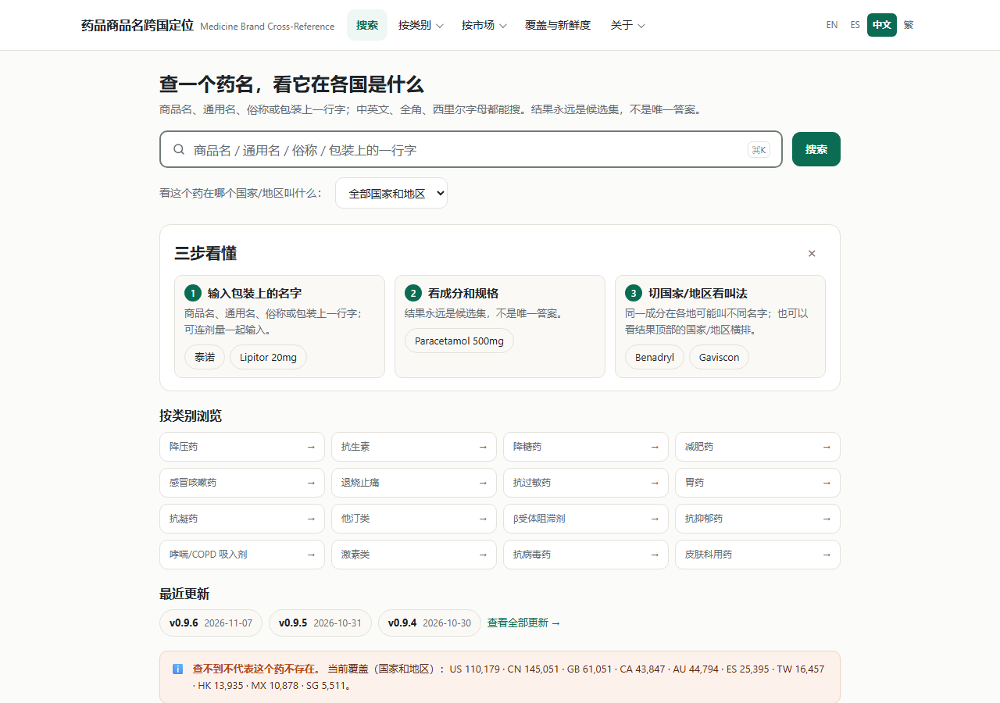
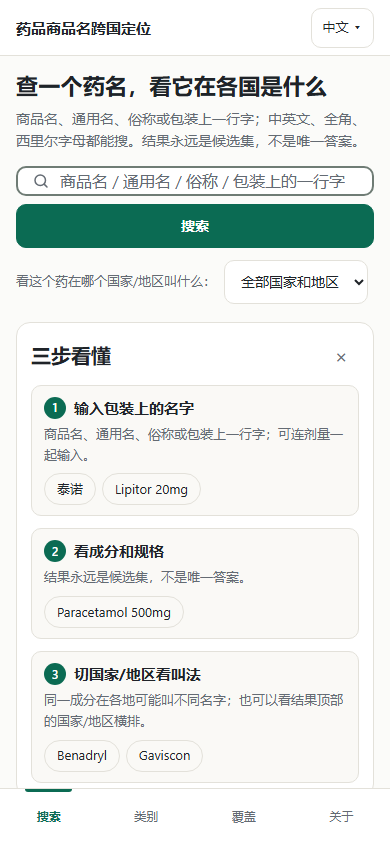
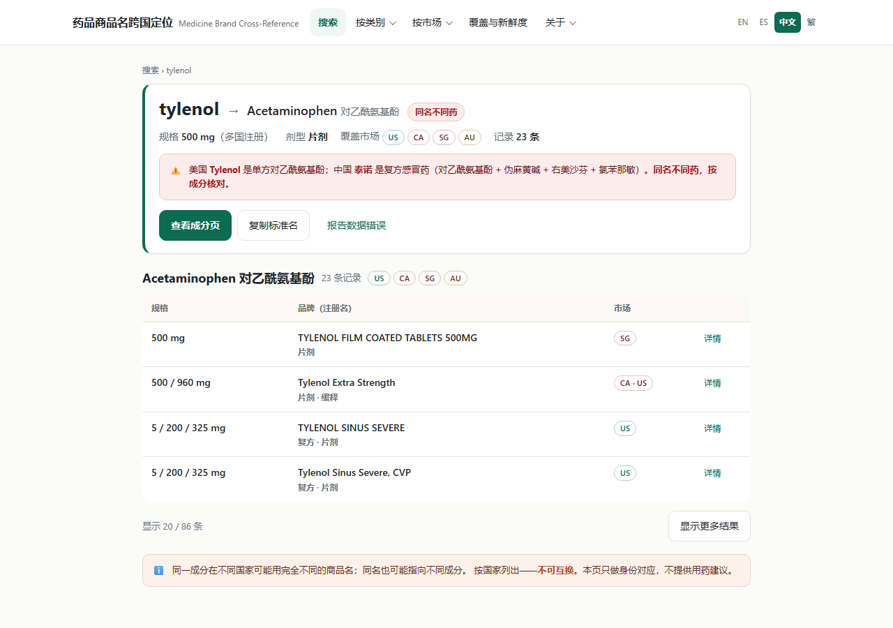
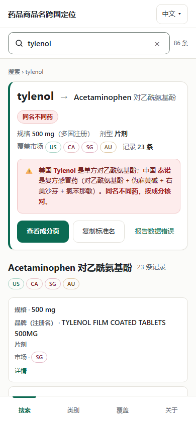
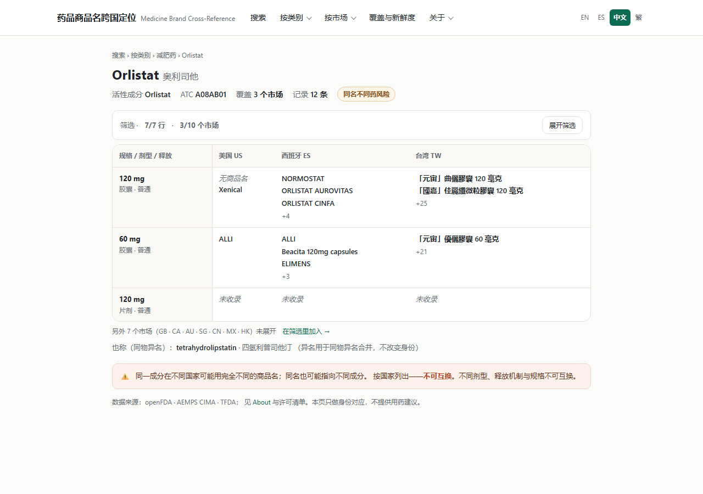
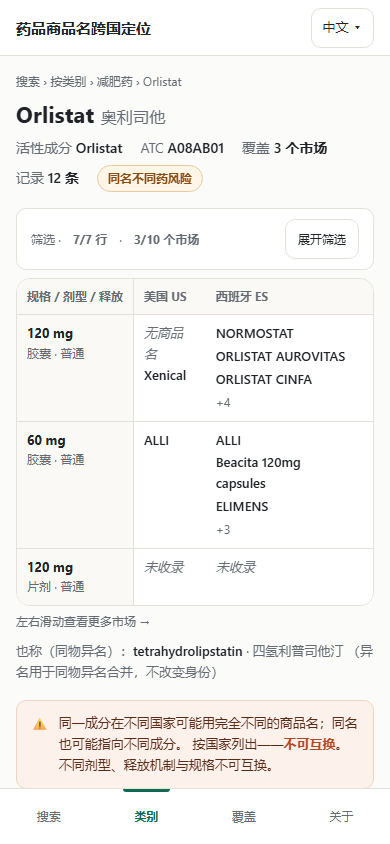
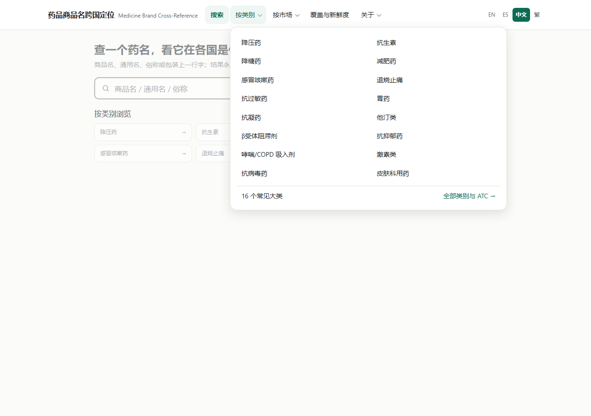
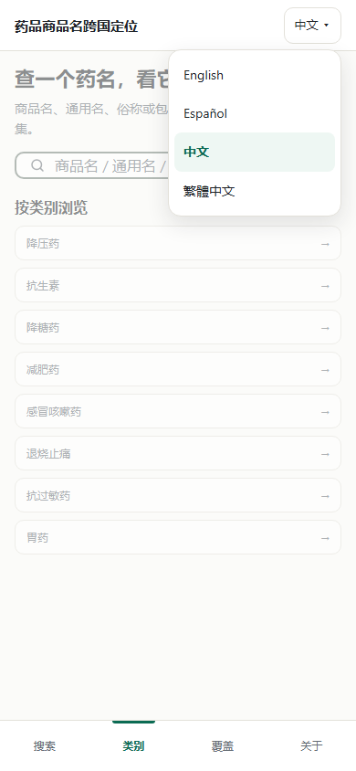
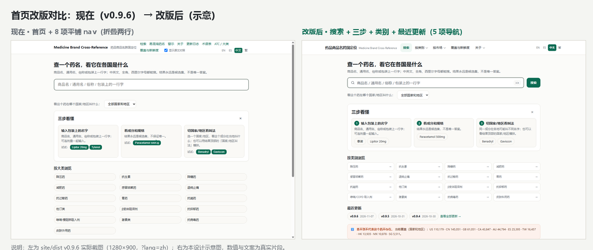

# UI 大修：设计示意图（mockup，2026-11-07）

> 配套文档：[docs/ui-overhaul-spec.md](ui-overhaul-spec.md)（审计 + 完整规格 + 批次计划）。
> 性质：**只有示意图与本文档**，未改 `site/build.py` / `data/` / `db/` / `deploy/`，未构建、未发布、未 commit。
> 生成方式：手写自包含 HTML（`.tmp/mockup/*.html`，无外部 CDN、无外部字体、无 JS 依赖），无头 Chrome
> `--headless=new --screenshot --window-size` 出图；移动 390 用 iframe 视口（Chrome 最小窗宽 500）再裁切。
> 设计基线：`docs/ui-overhaul-spec.md` §3.1 tokens（间距 4px 栅格 / 字号 5 档 / 颜色对比 ≥4.5:1 / 圆角 4 档）。
> 数据：真实片段（Tylenol / 对乙酰氨基酚 / 泰诺、Orlistat 与注册名、覆盖数字 v0.9.6 口径）；**只做身份对应，
> 不含用药建议与剂量换算**，品牌名只是注册名记录，不是推荐。

## 0. 一句话总览

| # | 图 | 尺寸 | 一句话 | 对应 spec |
|---|---|---|---|---|
| 1 | `home-desktop.png` | 1280×900 | 首屏只有「搜索 + 三步 + 类别 + 最近更新」，覆盖声明完整可见 | P0-4 / P0-6 / P1-10 |
| 2 | `home-mobile.png` | 390×844 | 390 下搜索框与结果入口同屏，底部 4 tab 常驻 | P0-4 / P0-5 / P0-7 |
| 3 | `results-desktop.png` | 1280×900 | `?q=tylenol`：身份卡置顶（成分/规格/市场/碰撞），下面才是结果表与「显示更多」 | P0-1 / P0-3 / P0-11 |
| 4 | `results-mobile.png` | 390×844 | 移动端 sticky 搜索条 + 身份卡 + 结果卡片，首屏就能看到答案 | P0-1 / P0-4 / P0-12 |
| 5 | `drug-desktop.png` | 1280×900 | 成分页固定层级：H1 → 一句话身份 → 矩阵（3 列）→ 异名 → 不可互换 | P0-9 / P1-1 |
| 6 | `drug-mobile.png` | 390×844 | 矩阵保留 3 列、横滑可达其余市场，警示在矩阵之后 | P0-9 / P0-7 |
| 7 | `shell-desktop.png` | 1280×900 | 桌面 5 项导航 + 「按类别」可展开面板（16 大类 + ATC 入口） | P0-6 / P0-10 |
| 8 | `shell-mobile.png` | 390×844 | 移动顶栏（语言常显）+ 底部 4 tab + 语言切换不再藏在汉堡里 | P0-5 / P0-7 |
| 9 | `before-after-home.png` | 1280×542 | 左旧右新并排：8 项平铺折两行 → 5 项 + 搜索优先 + 类别/最近更新 | 总览 P0-1…P0-12 |

## 1. 首页

| 桌面 1280 | 移动 390 |
|---|---|
|  |  |

**说明**：同一套 HTML 的响应式版本。桌面把「搜索框」提到 48px 高、紧接国家/地区筛选；3 步引导保留但压缩为一行三卡；
类别从原来的 3 列换成 4 列（16 个大类一屏可见 12 个）；「最近更新」是新增块（CHANGELOG 最近 3 个版本）；
底部「查不到 ≠ 不存在 + 覆盖数字」完整落在首屏。移动端搜索框 + 搜索按钮竖排，底部 tab 常驻。

**对应问题**：P0-4（移动首屏见搜索框/结果入口）、P0-6（导航收敛为 5 项）、P0-5（底部 tab + 语言常显）、
P0-7（触控 44px：按钮/输入/tab）、P1-10（tokens 收敛）、P1-11（断点 480/1024）。

**交互注释**
- 点搜索框：聚焦，弹出自动完成（复用现有 `#ac` 下拉）；输入≥1 字符触发前缀分片加载。
- 按 Enter / 点「搜索」：进入结果页（`/?q=<query>`），焦点保持在结果页 sticky 搜索。
- 点 ✕（移动 sticky 搜索）：清空查询、回首页空态。
- 点国家/地区下拉：切换后给结果加市场过滤（`?mk=US` 形式，可分享）。
- 点「三步看懂」的 ×：收起引导，写 `localStorage['u1.dismiss.v1']=1`（沿用现有键）。
- 点类别卡片：进入对应 `/cat/<id>.html`；点「最近更新」胶囊：进入 `/whats-new.html`。
- 底部 4 tab：搜索 → `/`（聚焦输入框）；类别 → `/atc.html`；覆盖 → `/coverage.html`；关于 → `/about.html`。
- 顶部「按类别 / 按市场 / 关于」：点开是 `<details>` 面板（无 JS 也能展开）；「覆盖与新鲜度」直达覆盖页。

## 2. 结果页（`?q=tylenol`）

| 桌面 1280 | 移动 390 |
|---|---|
|  |  |

**说明**：新增**身份卡**：查询名 → 成分（Acetaminophen 对乙酰氨基酚）+ 规格/剂型 + 覆盖市场 tag + 记录数 + 碰撞徽章
（沿用 `collision` / `dose_warning` 既有结论，**不做替代建议**），并在卡内给出「同名不同药」的一句话解释。
下面按成分分组列出注册名、规格、市场、剂型，底部「显示 20 / 86 条 + 显示更多结果」；最后是不可互换说明。
移动端：sticky 搜索条置顶（查询词 + 清除 + 条数），身份卡 + 结果卡片直接进入首屏。

**对应问题**：P0-1（身份卡置顶、H1 不再是营销语）、P0-3（分页/显示更多替代 1.7 MB 全量 DOM）、
P0-11（`#meta` 改 `role=status aria-live`，图中条数即读屏播报内容）、P0-12（加载骨架，见下）、P0-2（零结果 3 动作，未画，见 §7）。

**交互注释**
- 点「查看成分页」：进入 `/drug/<inn>.html`（身份卡顶部的主 CTA）。
- 点「复制标准名」：复制「INN + 规格 + 剂型」纯文本，toast 提示「已复制」。
- 点「报告数据错误」：打开 GitHub Issue 模板（沿用现有 `reportLink` 的 title/body 预填）。
- 点某行「详情」：行内展开（现有 `details` 行内展开模式），显示批准号 / 包装 / 来源。
- 点「显示更多结果」：追加下一批 10 条（或翻页，实现批二选一），更新「显示 N / 总数」。
- 移动端向下滚动：搜索条 sticky 在顶栏下方；点 × 清空并回到首页。
- 输入中文「泰诺」：命中同一成分，身份卡显示中文商品名与「同名不同药」提示（图中暗红色框）。

## 3. 成分页（Orlistat）

| 桌面 1280 | 移动 390 |
|---|---|
|  |  |

**说明**：按 spec §3.5 的固定层级重排：H1 → 一句话身份（ATC / 覆盖市场数 / 记录数）→ 国家矩阵（3 列 + 横滑 + 首列 sticky，
另 7 个市场折叠在「在筛选里加入」）→ 异名行 → 「不可互换」警示 → 数据来源。筛选器默认折叠成一行（原实现常显占 210px）。

**对应问题**：P0-9（层级与警示位置）、P1-1（多个 notice 合并为一个常显 + 其余折叠）、P0-7（筛选按钮 44px）、P1-6（空值不再重复成卡片）。

**交互注释**
- 点国家列表头 / 点「在筛选里加入 →」：展开市场勾选面板（多选，`?mk=` 同步 URL）。
- 左右滑动矩阵（移动）：横滑查看其余市场列；首列「规格/剂型/释放」sticky 常驻。
- 点「+4」「+25」：展开该单元格的其余注册名（行内 details），不跳页。
- 点品牌名：进入名字页 `/name/<slug>.html`；点异名：进入对应同物异名成分页。
- 点「展开筛选」：展开表单（剂型 / 释放 / 规格搜索 / 国家多选），移动端为底部抽屉。

## 4. 导航壳

| 桌面 1280 | 移动 390 |
|---|---|
|  |  |

**说明**：桌面主导航 5 项（搜索 / 按类别 / 按市场 / 覆盖与新鲜度 / 关于），「按类别」展开 16 大类 + ATC 入口，
市场面板带产品数（真实覆盖数字），关于面板收 Warnings / Confused / Glossary / What's new。移动端顶栏只有 logo + 语言切换
（不再是汉堡一层套一层），底部 4 tab 常驻；语言面板展开即选，带当前语言高亮。

**对应问题**：P0-6（8 项 → 5 项 + 面板）、P0-5（移动 nav 与语言切换可达）、P0-10（长尾页由 `boot.js` 注入同一套壳，避免 121k 页各加链接）。

**交互注释**
- 桌面 hover/点击「按类别」：`<details>` 展开面板；Esc 或点外部关闭；面板内每项直达 `/cat/*`。
- 「按市场」每行右侧是产品数，点整行进 `/coverage.html#<CC>`（或 P2 的市场子页）。
- 「关于」面板：One level down 的所有次级页（About / Glossary / What's new / Warnings / Confused），避免一级导航继续膨胀。
- 移动顶栏「中文 ▾」：展开语言列表（English / Español / 中文 / 繁體中文），选中即切换并记住。
- 底部 tab：4 项 44px 触控，选中项 accent 色 + 顶部 3px 指示条，`aria-current="page"`。

## 5. 前后对比（首页）



**说明**：左为 `site/dist` v0.9.6 实际截图（1280×900，`?lang=zh`）：8 项平铺 nav 折两行、语言与双语开关挤在第二行、
首屏是「标题 + 长说明 + 搜索」；右为本次设计示意：5 项导航 + 搜索优先 + 三步引导 + 4 列类别 + 最近更新 + 覆盖声明。
**对应问题**：P0-6（导航层级）、P0-4（首屏信息密度）、P1-10（字号/间距收敛）、P1-12（语言切换位置）。

## 6. 四语文案对照（示意用到的键）

> 规则：中文与英文是本次定稿文案；**西语（es）与繁体（zh-Hant）标「待译」**，由实现批补进
> `UI_I18N["zh-Hant"]` / `data/i18n_zh_hant.json`（现有机制，见 spec §3.4）。

| key | 中文（图中） | English | es | zh-Hant |
|---|---|---|---|---|
| `nav.categories` | 按类别 | Categories | 待译 | 待译 |
| `nav.markets` | 按市场 | Markets | 待译 | 待译 |
| `nav.coverage` | 覆盖与新鲜度 | Coverage & freshness | 待译 | 待译 |
| `nav.about` | 关于 | About | 待译 | 待译 |
| `tab.search` | 搜索 | Search | 待译 | 待译 |
| `tab.categories` | 类别 | Categories | 待译 | 待译 |
| `tab.coverage` | 覆盖 | Coverage | 待译 | 待译 |
| `tab.about` | 关于 | About | 待译 | 待译 |
| `search.clear` | 清除搜索（aria-label） | Clear search | 待译 | 待译 |
| `home.h1` | 查一个药名，看它在各国是什么 | Find out what a medicine really is | 待译 | 待译 |
| `home.sub` | 商品名、通用名、俗称或包装上一行字；中英文、全角、西里尔字母都能搜。结果永远是候选集，不是唯一答案。 | Brand name, generic name, nickname, or a line from the pack — Chinese, full-width and Cyrillic input all work. You always get a candidate set, never a single answer. | 待译 | 待译 |
| `res.identity` | 身份 | Identity | 待译 | 待译 |
| `res.identity.markets` | 覆盖市场 | Markets covered | 待译 | 待译 |
| `res.identity.records` | {n} 条记录 | {n} records | 待译 | 待译 |
| `res.not_interchangeable` | 同名不同药，按成分核对 / 跨市场不可互换 | Same name, different drug — check the ingredient / Not interchangeable across markets | 待译 | 待译 |
| `res.load_more` | 显示更多结果 | Show more results | 待译 | 待译 |
| `res.showing` | 显示 {n} / {total} 条 | Showing {n} of {total} | 待译 | 待译 |
| `res.empty.*` | 零结果 3 动作（未画，见 §7） | 3 actions on zero results | 待译 | 待译 |
| `matrix.more_markets` | 另外 {n} 个市场未展开 | {n} more markets | 待译 | 待译 |
| `drug.identity` | 活性成分 / ATC / 覆盖 / 记录 | Active ingredient / ATC / Markets / Records | 待译 | 待译 |
| `notice.not_interchangeable` | 同一成分在不同国家可能用完全不同的商品名；同名也可能指向不同成分。按国家列出——不可互换。 | The same ingredient can carry completely different brand names… listed by country — not interchangeable. | 待译 | 待译 |

## 7. 没有画进图里的部分（实现时按 spec 执行）

- **零结果 3 动作**（P0-2）：spec §3.5 有线框，本次 9 张图固定为「首页 / 结果 / 成分 / 导航」，没画零结果状态。
- **加载骨架**（P0-12）：图中未模拟 loading 态，实现时 `#out` 上方加 2–3 行 CSS 骨架 + `role=status` 播报。
- **筛选面板展开态、语言切换后的其他三语界面**：只画了当前语言（中文）与语言面板，四语值见 §6。
- **暗色模式**（P2-1）：spec 列为可选，未画。

## 8. 复现

```powershell
$py = 'C:\Users\asus\.dsh\dsh-runtimes\dsh-primary-runtime\dependencies\python\python.exe'
& $py .tmp\mockup\gen.py          # 生成 4 个自包含 HTML（首页/结果/成分/导航壳）
& $py .tmp\mockup\wrap.py         # 生成 390 视口 iframe 装帧页
# 桌面 1280×900
& 'C:\Program Files\Google\Chrome\Application\chrome.exe' --headless=new --disable-gpu `
  --hide-scrollbars --window-size=1280,900 --screenshot=docs\img\ui-mockup-20261107\home-desktop.png `
  "file:///<repo>/.tmp/mockup/home.html"
# 移动 390×844：截 500 宽窗口里的 390 iframe，再用 Pillow 裁到 390×844
& $py .tmp\mockup\finalize.py     # 裁切 + 生成 before-after-home.png
```

> `.tmp/mockup/` 是中间产物（gitignore），不入库；`docs/img/ui-mockup-20261107/` 下 9 张 PNG 是交付物。
