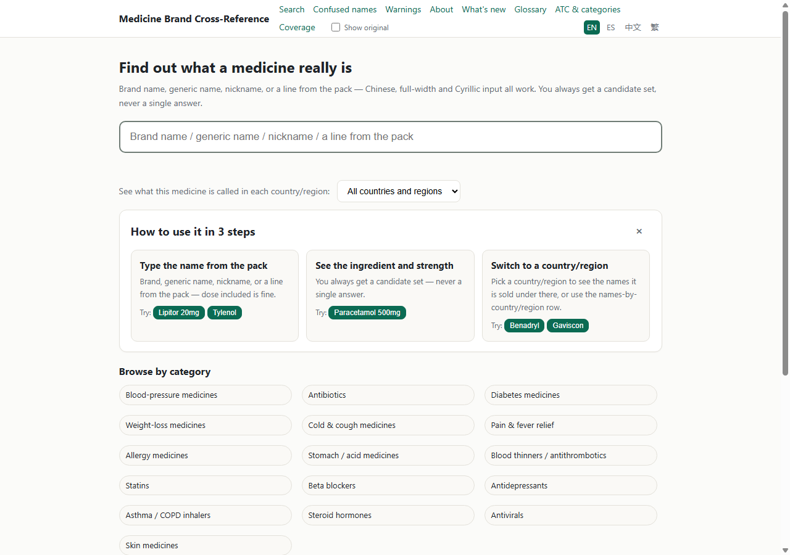
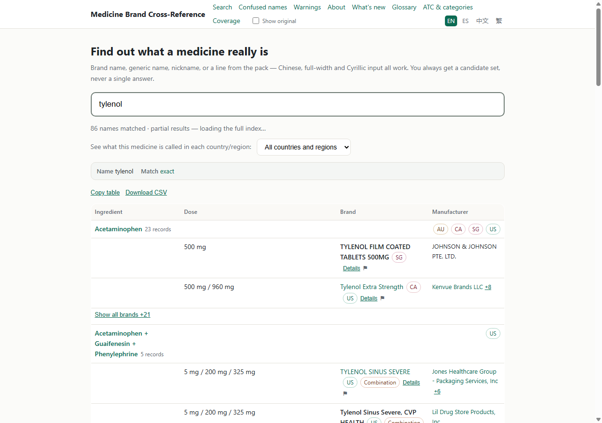
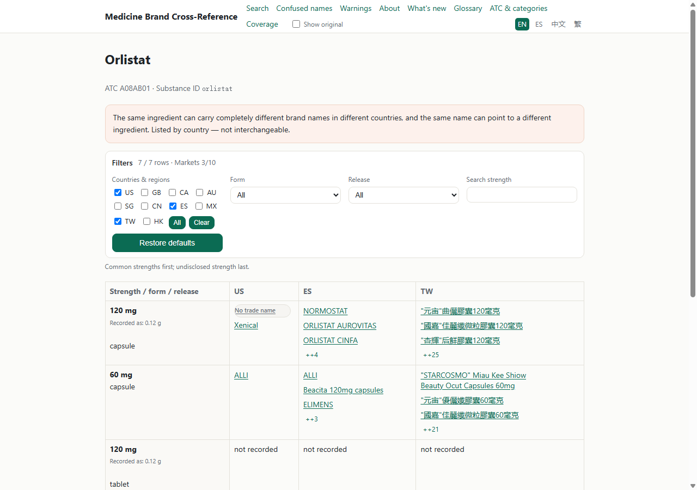
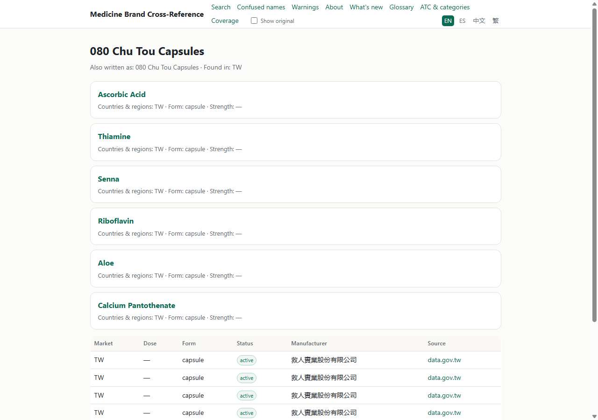
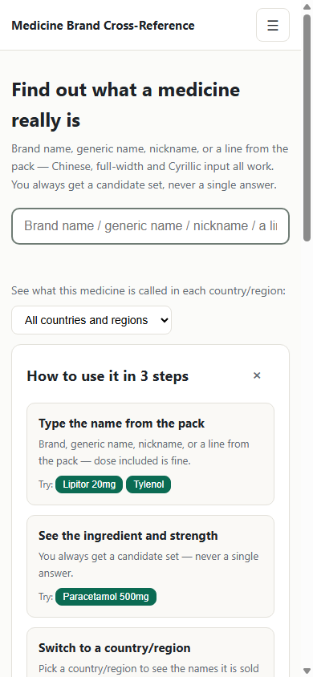
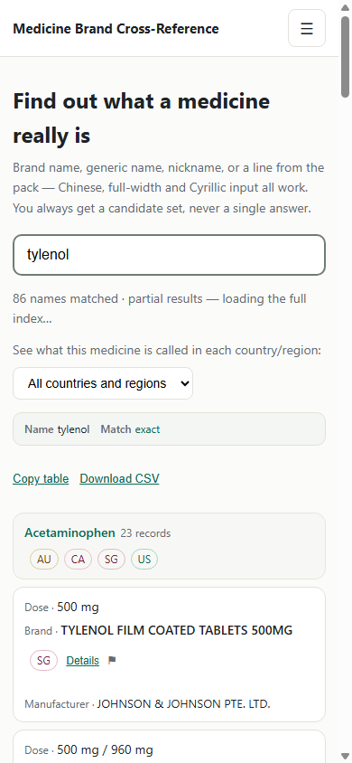

# UI 大修：现状审计与设计规格（2026-11-07）

> **性质**：只读审计 + 设计规格。未改 `site/build.py` / `data/` / `deploy/` / `db/`，未运行 `site/build.py`，未发布、未 commit。
> **审计对象**：`site/dist` 现产物（v0.9.6 内容，**121,292 文件 / 883,334,408 B / 883.3 MB / sitemap 63,363 URL / core 39.5 MB**），本地 `python -m http.server 8000 --directory site/dist` 渲染。
> **截图**：`docs/img/ui-audit-20261107/` 共 37 张（1280×900 桌面、390×844 移动、3 张 1280×2400 长页）。
> **⚠️ 与派单说明的差异（先看）**：任务书写「现 dist 是 v0.9.5（941 MB）」，实测 **dist 已经是 v0.9.6**：`whats-new.html` 首节 `v0.9.6 — 2026-11-07`，name 页瘦身后 883.3 MB（线上仍 v0.9.5，GitHub Pages 构建卡住，见 `docs/交接-20261107.md`）。**本文按 dist v0.9.6 审计；预算按 57.6 MiB 余量算，不要按 941 MB 旧口径。**

---

## 0. 结论（给决策者，30 秒版）

1. **骨架能用，缺的是「壳」**：11 类页面共用同一套 8 项平铺 nav；1280 宽下 nav 折成两行（第 1 行 7 项、第 2 行只剩 Coverage + 语言切换 + 双语开关），移动端整条 nav（含语言切换）收进汉堡。用户反馈「完全没有菜单」属实。
2. **结果页不是「身份卡」而是「首页 + 一张大表」**：H1 仍是首页营销语 `Find out what a medicine really is`，查询名只出现在 `parsebar` 里；`?q=tylenol` 一次搜索产出 **1.7 MB DOM / 212 行 / 13,478 个 `<a>`**，无分页、无「显示更多」。
3. **零结果只有 1 个动作**：DOM 里 `#out` 只有 `parsebar` + 空 `#artgbox`，唯一 CTA 是「Report this result」——没有「改写法 / 看类别 / 看覆盖」。
4. **长尾页与发现路径脱节**：成分页 / 名字页没有「按类别 / 按市场」入口，也没有 sticky 搜索；名字页**完全没有「不可互换」警示**（`notice=0`），成分页有警示但放错位置（在矩阵之前）。
5. **一条硬数学约束（决定实现方式）**：900 MiB 上限只剩 **60,383,992 B**，121,104 个 HTML 页 → **每页平均只剩 ≈499 B**。所以 **App Shell 的静态标记只能给顶层约 30 页；121k 长尾页的 shell 必须由 `boot.js` 注入**（一次文件改动，0 字节/页），否则大修必撞上限。
6. **既有优势别弄坏**：主色对比度全部 PASS（fg/bg 15.25:1、muted 5.21:1、accent 6.25:1、白字/accent 6.48:1）；表格有 `thead/th` + 移动端 `data-label` 卡片化；全站有 skip-link + `:focus-visible`。
7. **P0 共 12 条，一个构建批次（批次 A）可完成**；P1 14 条、P2 7 条。体积预算：CSS 25,976 B → ≤40 KB（余 14 KB）；**首页 HTML 205,532 B → +5% = ≤215,808 B**（只余 ≈10.3 KB，所有新增 CSS + i18n 键 + 标记都要挤进这 10 KB）。

---

## 1. 方法与复现

| 步骤 | 做法 |
|---|---|
| 本地渲染 | `& $py -m http.server 8000 --bind 127.0.0.1 --directory site/dist`（`$py` 见 AGENTS.md §2） |
| 截图 | headless Chrome（`--headless=new`），桌面 `1280×900`；移动 `390×844` 用 **iframe 视口**（Chrome 最小窗宽 500，直接 `--window-size=390` 会错），装帧页面放 `.tmp/ui-audit/frames/` |
| 结构证据 | 直接读 `site/dist` 的 HTML（只读）+ `--dump-dom` 取 JS 渲染后的结果页 DOM + `assets/style.css` 行号 |
| 对比度 | WCAG 2.1 相对亮度公式；脚本 `.tmp/ui-audit/outline_contrast.py`（17 组 token/背景，全部 PASS） |
| 页面计数 | 磁盘现查（drug 12,442 / name 77,058 / combo 15,191（含 8,455 noindex stub）/ maker 15,213 / atc 1,154 / cat 16 / 顶层 9 / 三语副本 21） |

**证据复现**（只读，随时可重跑）：

```powershell
$py = 'C:\Users\asus\.dsh\dsh-runtimes\dsh-primary-runtime\dependencies\python\python.exe'
& $py -m http.server 8000 --bind 127.0.0.1 --directory site/dist
# 渲染后 DOM（结果页 / 零结果）
& 'C:\Program Files\Google\Chrome\Application\chrome.exe' --headless=new --disable-gpu `
  --virtual-time-budget=25000 --dump-dom "http://127.0.0.1:8000/?q=tylenol&lang=en"
```

---

## 2. 现状审计

### 2.1 页面类型清单（11 类 + 3 个附加页）

| # | 类型 | 真实 URL（本地） | 字节 | h1 / h2 / h3 | 表格 | 截图（`docs/img/ui-audit-20261107/`） |
|---|---|---|---|---|---|---|
| 1 | 首页 | `/index.html?lang=en` | 205,532 | 1 / 3 / 0 | 0 | `home-en-1280.png` `home-en-390.png` `home-full.png`；四语：`home-zh-1280.png` `home-es-1280.png` `home-hant-1280.png` |
| 2 | 结果页（有结果） | `/?q=tylenol&lang=en` | 205,532（渲染后 DOM 2.03 MB，其中 `#out` 1.70 MB） | 1 / 3 / 2（`#out` 内） | 2 | `results-en-1280.png` `results-en-390.png` `results-full.png`；中文：`results-zh-1280.png` |
| 3 | 结果页（零结果） | `/?q=zzzzqqqxyz&lang=en` | 同上 | 1 / 3 / 0 | 0 | `results-zero-1280.png` `results-zero-390.png`（截停在 loading） |
| 4 | 成分页 | `/drug/orlistat.html?lang=en` | 28,732 | 1 / **0** / 0 | 1（matrix，10 国列，默认显 3） | `drug-1280.png` `drug-390.png` `drug-full.png`；异名版 `drug-alias-1280.png` |
| 5 | 名字页 | `/name/080-chu-tou.html?lang=en` | 8,760 | 1 / 6 / 0 | 1（6 列） | `name-1280.png` `name-390.png` |
| 6 | 组合页 | `/combo/13c-urea+urea+urea-13-c+urea-13c.html` | 5,516 | 1 / 3 / 0 | 1（3 列） | `combo-1280.png` `combo-390.png` |
| 7 | 厂家页 | `/maker/100-karma-inc.html?lang=en` | 10,218 | 1 / 2 / 0 | 1（3 列） | `maker-1280.png` `maker-390.png` |
| 8 | ATC | `/atc.html` + `/atc/C07AB.html`（+ L1 `/atc/C.html` 154 KB） | 23,085 / 12,187 | 1 / 2 / 0；ATC4 1 / 1 / 0 | 0（列表页） | `atc-1280.png` `atc-390.png` `atc4-1280.png` `atc4-390.png` |
| 9 | 覆盖页 | `/coverage.html?lang=en` | 11,011 | 1 / **0** / 0 | 1（7 列 × 10 行） | `coverage-1280.png` `coverage-390.png` |
| 10 | 关于页 | `/about.html?lang=en` | 25,546 | 1 / 8 / 0 | 1（**无 thead**） | `about-1280.png` `about-390.png` |
| 11 | 404 | `/404.html` | 1,739 | 1 / 0 / 0 | 0 | `404-1280.png` `404-390.png` |
| 12 | 警示页 | `/warn.html?lang=en` | 94,023 | 1 / **0** / **120** | 0 | `warn-1280.png` `warn-390.png` |
| 附 | 易混淆 | `/confused.html?lang=en` | 11,338 | 1 / 0 / 0 | 1 | `confused-1280.png` |
| 附 | 术语表 | `/glossary.html?lang=en` | 11,424 | 1 / 0 / 0 | 0 | `glossary-1280.png` |
| 附 | 消费者大类 | `/cat/acid-related.html?lang=en` | 35,061 | 1 / 2 / 0 | 0 | `cat-1280.png` |

**关键截图**（其余见附录 A；390 视口用 iframe 装帧成真实 390 CSS 像素，因为 headless Chrome 最小窗宽 500）

| 首页 1280 | 结果页 1280 |
|---|---|
|  |  |
| **成分页 1280（矩阵 / 筛选器 / 警示顺序）** | **名字页 1280（6 张成分卡占满首屏）** |
|  |  |
| **首页 390（只有 logo + 汉堡）** | **结果页 390（首屏 60% 是首页文案）** |
|  |  |

### 2.2 全局问题（影响所有页面）

**G1. 导航是「8 项平铺」，没有信息层级。**
`site/dist/index.html` 的 `<nav>` 是 8 个同级链接（Search / Confused names / Warnings / About / What's new / Glossary / ATC & categories / Coverage）+ 4 个语言链接 + 双语开关 = **13 个可点元素**；`assets/style.css:142-143` 用 `header nav{flex-wrap:wrap;row-gap:6px}` 覆盖了基础 `nowrap`，1280 宽下折成两行（第 2 行只有 Coverage + `Show original` + 语言）。证据：`home-en-1280.png`；移动端 `header nav{display:none}`（`style.css:35`），**语言切换也一起消失**（`.langs` 在 nav 内，`style.css:16`）。

**G2. 移动端没有常驻导航，也没有 sticky 搜索。**
CSS 里 `position:fixed` 出现 0 次、`position:sticky` 只有 2 处（都在矩阵首列，`style.css:327-328`）。移动端唯一导航入口是 40×40 汉堡（`style.css:29-31`）。结果页搜索框随页面滚走，长列表里改查询要手动滚回顶部。证据：`home-en-390.png`、`results-en-390.png`。

**G3. 触控目标普遍小于 44×44（项目自定 AA 门槛）。**
按 CSS 计算：`nav a` ≈22px（无 padding，`style.css:21-22`）、`.langs a` ≈23px（`padding:1px 5px` + 13px，`style.css:18`；移动端才补到 40px，`style.css:40`）、`.catchip` ≈33px（`padding:5px 10px` + 13px，`style.css:115-116`）、`.atccard` ≈40px（`style.css:81-82`）、`.u1try button` ≈27px（`padding:3px 8px` + 12px，`style.css:247`）、`.homeupd .updlist a` ≈33px（`style.css:122-124`）、`.nav-toggle` 40×40（`style.css:29-31`）、`.bil-toggle` ≈22px（`style.css:71-73`）。只有 `.linkbtn/.detbtn/.rowreport/...` 在 ≤719px 提到 44（`style.css:144-146`）。

**G4. 设计尺度不存在。**
CSS 里 `font-size` 有 **10 档**（11/12/13/14/15/16/17/18/20/24，共 111 处声明）、`border-radius` **9 种取值**（34 处声明：4/5/6/8/10/12/999 等）、`padding` **39 种取值**（63 处声明）、字号/间距全部 px、无 `rem`/`clamp`。断点 4 个且互相重叠：`max-width:1099px + min-width:768px`、`max-width:767px`、`max-width:719px`、`min-width:768px`（`style.css:24/32/144/286/332/343/362/399/445`）。

**G5. 没有暗色模式。** `prefers-color-scheme` 0 次；`color:#fff`、`#faf9f6` 等硬编码 40+ 处（404 页有 `color-scheme:light dark` 但只影响表单控件）。

**G6. 可访问性只做到「地基」，没做到「语义」。**
全站标准页有 skip-link + `main#main` + `:focus-visible`（`style.css:130-133`），但 **aria 属性几乎为零**：drug/name/combo/maker/atc/atc4/coverage/about/confused/glossary/cat 全部 **0 个 aria-\***（home 6 个、warn 4 个）。搜索状态 `#meta` 没有 `role="status"/aria-live`（只有 `parsebar` 有 `role="status"`），筛选器折叠按钮无 `aria-expanded`。

**G7. 四语实现方式带来「双份体积 + 单语可见」。**
四语文本以 `.lang-block` 内联在 HTML 里（atc/warn 各 240 个、cat 32 个、atc4 24 个），CSS 只显示当前语言（`style.css:406-407`）。好处是无 JS 也有英文；代价是页面膨胀、H1 里多语言拼接（见 P1-2）。

**G8. 壳的扩展空间只剩 ≈499 B/页。**
900 MiB = 943,718,400 B；现 dist 883,334,408 B → 余量 60,383,992 B；121,104 个 HTML 页 → **498.6 B/页**。任何「给每页 static 加 1–2 KB 导航」的方案都会多出 120–240 MB，直接撞上限。**结论：shell 静态只给顶层页，长尾页由 `boot.js` 注入（沿用 task-142 的 pattern）。**

### 2.3 逐页问题（P0 / P1 / P2）

> 每条格式：**问题 → 页面 + 元素/选择器 → 证据 → 影响**。截图文件名都在 `docs/img/ui-audit-20261107/`。

#### P0（12 条，批次 A）

| ID | 问题 | 页面 + 元素 | 证据 | 影响 |
|---|---|---|---|---|
| **P0-1** | 结果页没有「身份卡」；H1 是首页营销语 | `/`（带 `?q=`）：`<h1 data-i18n="home.h1">` 仍为 `Find out what a medicine really is`；查询名只在 `.parsebar` 与 `#q` 里 | `results-en-1280.png`、`results-zh-1280.png`；渲染 DOM `#out` 顶层块依次为 `parsebar / u2bar / restools / table.res ×2 / notice`，无单条身份摘要 | ①「查这个药是什么」的核心答案要滚到 y≈430（桌面）/ y≈525（390）；② SEO / 分享标题与查询无关 |
| **P0-2** | 零结果只有 1 个动作 | `/?q=zzzzqqqxyz`：`#out` 只有 `parsebar`（`Match: no match`）+ 空 `<div id="artgbox">`；唯一 CTA 是 `#reportLink` | `--dump-dom` 零结果 DOM（`.tmp/ui-audit/dom-results-zero.html`）；`results-zero-1280.png` | 用户被卡死：不知道怎么改写法、看不到类别、也到不了覆盖页 |
| **P0-3** | 结果页不分页、无「显示更多」，DOM 巨大 | `/?q=tylenol`：`#out` = **1,703,225 字符 / 212 `<tr>` / 185 个 `st-badge` / 13,478 个 `<a>` / 2 张表** | DOM 统计（`.tmp/ui-audit/analysis_results.txt`）；`results-full.png`（2400px 仍没到底） | 移动端流量与内存、滚动疲劳；表里同一品牌在多列重复出现（品牌列 + 同成分表） |
| **P0-4** | 移动端无粘性搜索条；结果页首屏 60% 是首页文案 | `/` 移动：`.searchwrap` 非 sticky；390 下结果第一块从 y≈525 开始 | `results-en-390.png`；CSS 中 `position:fixed`=0、`sticky` 仅矩阵列 | 长列表里改查询必须回到顶部；「结果入口」在首屏很弱 |
| **P0-5** | 移动端无常驻导航；语言切换不可达 | `<768px`：`header nav{display:none}`；`.langs` 在 nav 内 | `style.css:35`、`home-en-390.png`（只有 logo + 汉堡） | 从结果/成分页去类别、覆盖、关于都要先开汉堡；语言切换藏两层 |
| **P0-6** | 桌面导航平铺 8 项且折两行，没有「按类别 / 按市场」入口 | `<nav>`（`page()` 模板）；1280 下第 1 行 7 项、第 2 行 Coverage + `Show original` + 语言 | `home-en-1280.png`；`style.css:142-143` | 用户反馈「完全没有菜单」；类别/市场只能从首页 chips 或 ATC 页绕进去 |
| **P0-7** | 触控目标 <44px（6 类） | nav 22 / langs 23 / catchip 33 / atccard 40 / u1try button 27 / homeupd 33 | 见 G3（CSS 行号） | 手指误触；与项目自定 AA 冲突 |
| **P0-8** | 名字页没有「不可互换」警示；6 张成分卡占满首屏 | `/name/080-chu-tou.html`：`notice=0`；首屏 6 张 `.card`（Ascorbic Acid…Calcium Pantothenate），产品表从 y≈720 才开始 | `name-1280.png`、`name-390.png`；HTML `class="notice"` 计数 0 | 名字页是最容易被误解为「等价药」的页面，缺警示是合规风险 |
| **P0-9** | 成分页层级混乱：无 h2、警示在矩阵前、筛选器占首屏 | `/drug/orlistat.html`：`h2=0`（全部 `<p class="sub">`）；顺序为 H1 → meta 行 → 警示框 → Filters（10 个市场勾选 + 3 个下拉 + 3 个按钮，≈210px）→ 矩阵 | `drug-1280.png`、`drug-390.png`；outline 提取（`.tmp/ui-audit/outline_contrast.txt`） | 用户先看到「不可互换」大框和筛选器，才看到身份与矩阵；层级与 Lead 定的「H1 → 一句话身份 → 矩阵 → 异名 → 警示」相反 |
| **P0-10** | 长尾页无法静态承载新壳（预算 499 B/页） | 121,104 页 × 1.5 KB ≈ 180 MB ≫ 57.6 MiB | G8 的算术；`reports/task146-size-budget-20261031.md` | 决定实现方式：**外层壳静态只给顶层页，长尾页 boot.js 注入**（否则大修做不完） |
| **P0-11** | 搜索/结果状态没有 aria-live；折叠控件无 aria-expanded | `#meta.search-status`（无 role/aria-live）；`.mf-toggle`、`.atcdetails`、`.atc4forms`、`.m-more` 的 `<summary>` 均无 aria-expanded | `home` aria=6（都在输入框）；其余页 aria=0 | 屏幕阅读器不会播报「N 个结果 / 零结果 / 正在加载」 |
| **P0-12** | 加载态只有一行裸文本，无骨架/进度 | `/?q=tylenol` 首次输入：`#meta` 只有 `Loading index…`；390 下 30–60s 虚拟时间仍停在该状态（截图） | `results-zero-390.png`；`home.loading` / `res.partial` 文案 | 首搜等待无反馈，用户以为坏了；零结果更糟（等待后只给一句话） |

#### P1（14 条，批次 B）

| ID | 问题 | 页面 + 元素 | 证据 |
|---|---|---|---|
| **P1-1** | ATC4 页 4 个 `.notice` 堆叠在页尾（不可互换 / 状态徽章 / 译名 / 许可） | `/atc/C07AB.html`：`notice=4` | `atc4-1280.png` |
| **P1-2** | H1 四语拼接 + h1/h2 重复：ATC4 H1 DOM 文本为 `C07AB Selective beta-1 blocking agentsBetabloqueantes selectivos…`；`/atc.html` 的 h1 与 h2 都是 `Browse by ATC class` | `<h1>` 内 4 个 `.lang-block`；`build_atc_index()` 用了两次 `atc.browse_title` | `atc4-1280.png`、`atc-1280.png`、outline 提取 |
| **P1-3** | 覆盖页移动端 7 字段卡片过长；`Last sync` 时间戳折行；无排序/筛选 | `/coverage.html`：390 下每市场一张 7 行卡；`2026-10-26T13:57:32-07:00` 在桌面折 3 行 | `coverage-390.png`、`coverage-1280.png` |
| **P1-4** | 警示页 h1→h3 跳级（`h2=0`、`h3=120`）；无严重度筛选；meta 混入中文（英文界面出现「茶碱 / 待第二人复核」） | `/warn.html` | `warn-1280.png`、`warn-390.png`；a11y 提取 |
| **P1-5** | About 表格无 `<thead>`（`<tr><th>` 直接进 tbody）；许可段极长 | `/about.html`：`table_has_thead=false` | 结构提取（`.tmp/ui-audit/evidence_dom.json`）、`about-1280.png` |
| **P1-6** | 名字页空值噪音：6 张卡都写 `Strength: —`；`Also written as:` 与 H1 重复（同字符串） | `/name/080-chu-tou.html` | `name-1280.png` |
| **P1-7** | 组合页成分列表重复显示 code（`13C-Urea 13c-urea` ×4） | `/combo/13c-urea+…` | `combo-1280.png` |
| **P1-8** | 404 无壳：无 nav / footer / skip-link / 语言切换，只有 4 个链接 | `/404.html`（1,739 B，内联样式） | `404-1280.png`、`a11y_evidence.txt` |
| **P1-9** | 术语表/易混淆页无 h2 分组（`h2=0`） | `/glossary.html`、`/confused.html` | 结构提取 |
| **P1-10** | 字号/圆角/间距无尺度（见 G4） | `assets/style.css` | 统计：10 档字号（111 处）/ 9 种圆角（34 处）/ 39 种 padding（63 处） |
| **P1-11** | 断点四档重叠（719/767/768/1099） | `assets/style.css` | 同上 |
| **P1-12** | 语言切换与双语开关挤在 nav 第二行，12px 小字，无 aria-current | `<nav>` 内 `.langs`、`.bil-toggle` | `home-en-1280.png` |
| **P1-13** | `#meta` 位置由 JS 搬到搜索框下，`.mf-slot{min-height:170px/92px}` 只是占位，筛选器真实高度不同 → CLS 风险 | `style.css:285-286`；`APP_JS` 里 `insertAdjacentElement` | CSS + `results-en-1280.png` |
| **P1-14** | 大表无排序/密度控制（结果 212 行、覆盖 10 行、厂家 15,213 页） | `table.res`、`table.matrix` | DOM 统计 |

#### P2（7 条，批次 C）

| ID | 问题 | 证据 / 备注 |
|---|---|---|
| **P2-1** | 无暗色模式 | `prefers-color-scheme` = 0；Lead 列为可选 |
| **P2-2** | 首页内联 i18n 162,493 B（占首页 HTML 79%），只用到 1 种语言 | `assets/i18n.js` 162,493 B、首页 HTML 205,532 B；按语言分包可省 ≈120 KB |
| **P2-3** | 首页内联全部 CSS 26 KB（`_optimize_home_html()`） | 与 P2-2 一起可给首页腾出 145 KB 空间，但会影响 LCP 策略，需单独评估 |
| **P2-4** | 没有市场维度落地页（只有首页下拉 + 覆盖表） | 目录里无 `market/`；见 §3.3「按市场」方案 |
| **P2-5** | 结果工具条 `Copy table / Download CSV` 是 13px 文字链 | `results-en-1280.png` |
| **P2-6** | 移动端卡片化后 `table.matrix` 的 sticky 首列规则仍在 | `style.css:327-328` vs `style.css:343-356` |
| **P2-7** | 术语表用 `dl.glossary` 无分组标题 | `/glossary.html` |

### 2.4 已达标项（大修不要弄坏）

- **对比度**：17 组全部 ≥4.5:1（`fg` 15.25、`muted` 5.21/5.39、`accent` 6.25/6.48、`warn` 4.91、`sev` 6.89、10 个国家 tag 6.25–8.24、状态徽章 4.95–7.67）。
- **表格语义**：`table.res / table.matrix / table.det / .atc4forms` 都有 `thead/th`；移动端用 `data-label` 变卡片（`style.css:376-397`）。
- **跳过链接 + 焦点环**：skip-link（`style.css:130-132`）、`:focus-visible{outline:3px solid}`（`style.css:133`）。
- **输入框可见性**：`#q` 2px 深色边框（`style.css:141`）。
- **矩阵默认 3 列 + 横滑 + sticky 规格列**（v0.9.0 已做，`style.css:268-355`）。
- **静态可读**：无 JS 时所有页面有英文正文；语言块用 CSS 隐藏（`style.css:406-407`）。

---

## 3. 设计规格

### 3.1 设计 tokens（全部落进 `CSS` 常量，`site/build.py:2511` 起）

**间距（4px 栅格，8 档，替换现有 39 种 padding）**

| token | 值 | 用途 |
|---|---|---|
| `--s1` | 4px | 图标/徽章内边距 |
| `--s2` | 8px | 行内 gap、chip 横向间距 |
| `--s3` | 12px | 卡片内边距（紧凑）、表单元格 |
| `--s4` | 16px | 卡片内边距、表单间距 |
| `--s5` | 24px | 区块间距、页面左右（移动） |
| `--s6` | 32px | 大区块间距 |
| `--s7` | 48px | 首屏留白 |
| `--s8` | 64px | 页脚上方 |

**字号（5 档，替换 10 档）**

| token | 值 / 行高 | 用途 |
|---|---|---|
| `--fs-xs` | 12px / 1.4 | 徽章、来源小字、表格表头 |
| `--fs-sm` | 14px / 1.5 | 次级正文、meta、筛选项 |
| `--fs-md` | 16px / 1.6 | 正文、按钮、输入 |
| `--fs-lg` | 20px / 1.35 | h2、卡片标题、引导步骤标题 |
| `--fs-xl` | 24px / 1.25 | h1（移动端 22px 用 `clamp()` 或媒体查询） |

**颜色（保留现有 6 个核心 token，新增 4 个；都已核对对比度）**

| token | 值 | 对比度（on `--bg #fbfbf9`） | 说明 |
|---|---|---|---|
| `--bg` | `#fbfbf9` | — | 页面底 |
| `--fg` | `#1f2328` | 15.25:1 | 正文 |
| `--muted` | `#646b73` | 5.21:1 | 次级文字（13–14px 可用） |
| `--line` | `#e3e1da` | 边框（无文字要求） | 分隔线 |
| `--card` | `#fff` | — | 卡片底 |
| `--surface-2` | `#faf9f6` | — | 次级块底（矩阵规格列、chip） |
| `--accent` | `#0b6b53` | 6.25:1 | 主色/链接 |
| `--accent-weak` | `#eef7f3` | — | hover/选中底 |
| `--warn` | `#b4471f` | 4.91:1 on `#fdf1ec` | 不可互换警告 |
| `--sev` | `#a01b1b` | 6.89:1 on `#fdecec` | 严重碰撞 |
| `--focus` | `#0b6b53` | 6.25:1 | 焦点环（3px） |
| `--overlay` | `rgba(31,35,40,.12)` | — | 下拉/面板阴影 |

> 暗色模式（P2）：新增 `@media (prefers-color-scheme: dark)` 只覆盖 token 值，组件 CSS 不改；对比度同样要 ≥4.5:1。

**圆角（4 档，替换 9 种）**：`--r-sm:6px`（徽章/小控件）、`--r-md:10px`（按钮/输入/卡片）、`--r-lg:14px`（面板/空状态）、`--r-pill:999px`（chip/tag）。

**阴影（1 档）**：`--shadow-1: 0 8px 24px var(--overlay)`（下拉、底部面板）。

**层级**：`--z-sticky:10`（结果页 sticky 搜索）、`--z-ac:30`（自动完成，沿用）、`--z-header:40`、`--z-panel:50`、`--z-toast:60`。

### 3.2 组件清单（状态 / 尺寸 / token 用法）

| 组件 | 变体 | 尺寸（高） | 关键规则 |
|---|---|---|---|
| **Button** | primary（accent 底白字）/ secondary（白底 + line 边）/ ghost（文字）/ icon | 44（触控视口 ≤1024）；36（桌面紧凑） | 圆角 `--r-md`；`:focus-visible` 3px；禁用态 `opacity:.5` + `cursor:not-allowed`；不新增第二种主色 |
| **Tag / Badge** | 国家 tag（10 色沿用 `style.css:60-69`）/ 状态 chip（active/discontinued/withdrawn/unknown）/ 严重度 badge（High/Medium/Info） | 22 | 12px；`--r-pill` 或 `--r-sm`；**颜色不动**（对比度已达标） |
| **Card** | 身份卡（identity）/ 结果卡 / 分组卡 / 成分卡 | 自适应 | padding `--s4`；`--r-lg`；标题 `--fs-lg`；meta `--fs-sm --muted`；动作行 44px；卡片之间 `--s3` |
| **Table** | 数据表（`.res`）/ 矩阵（`.matrix`）/ 紧凑明细（`.det`） | 行高 40（触控视口 44） | 必须有 `thead/th` + `scope="col"`；移动端 ≤480 卡片化（沿用 `data-label` 机制）；矩阵默认显示 3 列（≤480）/ 5 列（>1024），其余列**横滑可达（不再用 `display:none` 藏起来）**，首列 sticky；超过 50 行必须分页或「显示更多」 |
| **Input / Search** | 搜索框（首页/结果页 sticky）、筛选输入 | 48（桌面）/ 44（触控） | 2px 边框；右侧清除按钮 44×44（`aria-label`）；`:focus-visible` |
| **EmptyState** | 零结果 / 空类别 / 空厂家 | — | h2 `--fs-lg` + 一句解释 + **3 个动作**（见 §3.5 结果页线框）+ 报告链接 |
| **NavItem / NavPanel** | 桌面主导航项 / 展开面板 | 44 | `<details><summary>` 无 JS 可展开；`aria-current="page"`；面板 2 列 grid、最大宽 1040 |
| **TabBar** | 移动底部 4 tab | 56 + `env(safe-area-inset-bottom)` | 文字 + 3px 顶部选中条；每项 ≥44×44；`aria-current` |
| **Notice** | 警示（warn）/ 提示（info）/ 许可（collapsible） | — | 一页最多 1 个常显 notice，其余折叠进 `<details>`（修 P1-1） |
| **Skeleton** | 结果页加载骨架（2–3 行） | — | 纯 CSS 动画，`prefers-reduced-motion` 时静态灰块（修 P0-12） |

### 3.3 App Shell（统一壳）

**桌面（>1024px）—— 顶部一行，可展开的 5 项导航**

```
┌ header 64px ────────────────────────────────────────────────────────────────┐
│ 药品商品名跨国定位  Medicine Brand Cross-Reference                          │
│   [Search]  [Categories ▾]  [Markets ▾]  [Coverage]  [About ▾]    EN|ES|中文|繁 │
└──────────────────────────────────────────────────────────────────────────────┘
   Categories ▾（<details> 面板，2 列）：16 个消费者大类 + “All ATC classes & categories →”
   Markets ▾（<details> 面板，2 列）：10 个市场 + 产品数（链到 coverage.html#XX 或 /market/XX.html）
   About ▾：About / Glossary / What's new / Warnings / Confused names
```

- 导航项从 8 → **5**（Search / Categories / Markets / Coverage / About），Warnings、Confused、Glossary、What's new 收进 About 面板；页脚保留全站链接（SEO 内链不断）。
- 「Search」= 回首页并聚焦输入框；结果页时当前项高亮。
- 语言切换独立成 `.langs`，始终可见（桌面右、移动顶部栏），`aria-current` 标当前语言。
- 主体宽度：正文 `--wrap:920px` 不变；表格/矩阵页用 `.wrap--wide{max-width:1120px}`（只影响 data 页，不影响阅读页）。

**移动（≤480px）—— 顶部栏 + 底部 tab + 结果页 sticky 搜索**

```
┌ 顶部栏 56：logo（可点回首页）            EN▾（语言切换）┐
├ 结果页专属 sticky 搜索 56：🔍 [tylenol        ×] 12 条 ┤  ← position:sticky; top:0; z-index:10
│ 内容（padding-bottom: 72px 给 tab 让位）                │
└ 底部 tab 56：  [搜索]  [类别]  [覆盖]  [关于]  ┘  ← 4 项，44×44，aria-current
```

- 结果页 sticky 搜索只在 `?q=` 存在时出现；带清除按钮（`aria-label="Clear search"`），点清除回首页空查询。
- 底部 tab 固定 4 项；「类别」落到 `/atc.html`，「覆盖」落到 `/coverage.html`，「关于」落到 `/about.html`。
- 481–1024px：不显示底部 tab，用汉堡展开的多行 nav（沿用现有 `nav-open` 模式）+ 顶部 sticky 搜索；**语言切换在顶部栏常显**。

**长尾页面的壳（关键实现约束）**

| 页面范围 | 壳的实现 | 体积成本 |
|---|---|---|
| 顶层 ~30 页（index/about/coverage/warn/confused/atc/glossary/whats-new/404 + 三语副本） | **静态 HTML**：新 nav + 底部 tab + sticky 搜索 | ≈2 KB/页 × 30 ≈ 60 KB |
| 长尾 121,104 页（drug/name/combo/maker/atc 子页/cat） | **`boot.js` 注入**（沿用 `_coverage_entry_js()` 的幂等模式）：一次文件 +2–3 KB，0 字节/页 | ≈3 KB 总计 |
| 无 JS 降级 | 长尾页保留现有 7 项 nav，不显示底部 tab/sticky（可接受） | 0 |

> 依据：G8（498.6 B/页）。`boot.js` 已由 `page()` 以 `defer` 引入（非首页），`boot.js` 现在只有 1,135 B，加完 shell 注入预计 ≤4 KB，仍在「不阻塞 JS」内。

### 3.4 导航层级与四语文案键（zh + en；es / zh-Hant 标「待译」）

**层级**

```
一级（桌面 5 / 移动 4）
├─ Search            → /（聚焦搜索框）
├─ Categories        → 面板：16 消费者大类 + /atc.html
│   ├─ <16 个 cat/*.html>
│   └─ All ATC classes & categories → /atc.html
├─ Markets           → 面板：10 个市场（US/GB/CA/AU/SG/CN/ES/MX/TW/HK）
│   └─ 每项 → /coverage.html#<CC>（现有表行加 anchor）或 /market/<CC>.html（P2 可选）
├─ Coverage          → /coverage.html
└─ About             → 面板：/about.html、/glossary.html、/whats-new.html、/warn.html、/confused.html
```

**新增 i18n 键**（复用现有 `nav.search / nav.about / nav.coverage / nav.atc / nav.warn / nav.confused / nav.glossary / nav.whatsnew / cat.quick_title / cat.browse_title / atc.browse_title / home.* / res.* / matrix.* / report.*`）

| key | en | zh | 用途 | es / zh-Hant |
|---|---|---|---|---|
| `nav.categories` | Categories | 按类别 | 桌面一级 | 待译 |
| `nav.markets` | Markets | 按市场 | 桌面一级 | 待译 |
| `nav.more` | More | 更多 | 面板收起态（可选） | 待译 |
| `nav.all_categories` | All categories & ATC classes | 全部类别与 ATC | 面板底部链接 | 待译 |
| `nav.market_counts` | {n} products | {n} 个产品 | 市场面板小字 | 待译 |
| `tab.search` | Search | 搜索 | 底部 tab | 待译 |
| `tab.categories` | Categories | 类别 | 底部 tab | 待译 |
| `tab.coverage` | Coverage | 覆盖 | 底部 tab | 待译 |
| `tab.about` | About | 关于 | 底部 tab | 待译 |
| `search.clear` | Clear search | 清除搜索 | 清除按钮 `aria-label` | 待译 |
| `search.sticky_hint` | Search again | 重新搜索 | sticky 条（可选） | 待译 |
| `res.identity` | Identity | 身份 | 身份卡标题 | 待译 |
| `res.identity.ingredient` | Active ingredient | 活性成分 | 身份卡字段 | 待译 |
| `res.identity.strength` | Strength | 规格 | 身份卡字段 | 待译 |
| `res.identity.markets` | Markets covered | 覆盖市场 | 身份卡字段 | 待译 |
| `res.identity.records` | {n} records | {n} 条记录 | 身份卡字段 | 待译 |
| `res.not_interchangeable` | Not interchangeable across markets | 跨市场不可互换 | 身份卡警示行 | 待译 |
| `res.empty.title` | No match for “{q}” | 没有匹配「{q}」 | 零结果标题 | 待译 |
| `res.empty.spelling` | Check the spelling, or try the generic name | 检查拼写，或改用通用名 | 动作 1（含 2 个示例 chip） | 待译 |
| `res.empty.browse` | Browse by category | 按类别浏览 | 动作 2 | 待译 |
| `res.empty.coverage` | See coverage & freshness | 看覆盖与新鲜度 | 动作 3 | 待译 |
| `res.load_more` | Show more results | 显示更多结果 | 分页/加载更多 | 待译 |
| `res.showing` | Showing {n} of {total} | 显示 {n} / {total} | 结果计数 | 待译 |
| `matrix.more_markets` | +{n} more markets | 还有 {n} 个市场 | 矩阵列提示 | 待译 |
| `notfound.home` | Back to search | 回到搜索 | 404 | 待译 |

> 实现注意：zh-Hant 不能只靠回退 —— 新键必须同时写进 `UI_I18N["zh-Hant"]`（这是 `_install_zh_hant()` 的显式覆盖层），否则繁体界面会掉回简体（现有机制见 `site/build.py:1862-1887`）。

### 3.5 页面线框（文字 + 结构）

**首页 `/`（改：P0-4/6/7）**
```
H1 查一个药名，看它在各国是什么
一句话说明（≤2 行）
[ 搜索框 48px ................ × ]        ← 移动端首屏必须完整可见
[国家/地区筛选]（可选，折叠成 “More filters”）
身份卡空态引导：3 步（输入 → 看成分/规格 → 切国家）   ← 保留现有 u1guide，不常驻（可关）
按类别浏览（16 chip，40px 高，触控 44 有效区）
最近更新（3 个版本）
覆盖声明（查不到 ≠ 不存在）
```

**结果页 `/?q=`（改：P0-1/2/3/11/12）**
```
（移动）顶部栏 + sticky 搜索（q + 清除 + “12 条”）
面包屑：Search › 「tylenol」
身份卡（新）：
   H1  tylenol  →  Acetaminophen（+ 化合物名）
   规格 500 mg · 剂型 tablet
   市场覆盖 US CA SG AU（tag 行）
   [严重碰撞] 同名不同药：Tylenol / 泰诺（沿用 collision 结论，不做替代建议）
   动作：[看成分页] [复制标准名] [报告]（44px）
结果分组（每成分一组，≤10 行/组）：
   Acetaminophen 23 records  [AU][CA][SG][US]
   ┌ 500 mg · TYLENOL FILM COATED TABLETS 500MG · SG · [Details] ┐
   …（组内“显示更多 +21”）
分页：Showing 20 of 86 · [Show more]（或 20/页分页）
页尾：不可互换提示 + 数据来源
```

**零结果（改：P0-2）**
```
H1 没有匹配「zzzzqqqxyz」
一句话：空结果不代表这个药不存在。
动作 1：检查拼写 / 试通用名 —— [Paracetamol 500mg] [Tylenol]
动作 2：按类别找 —— [16 chip 或 4 个常用类别 + “全部类别”]
动作 3：看覆盖 —— [覆盖与新鲜度]
（保留）报告数据错误
```

**成分页 `/drug/<inn>.html`（改：P0-9，对齐 Lead 定的层级）**
```
H1  Orlistat
一句话身份：Orlistat · ATC A08AB01 · 3 个市场有记录 · 12 条产品记录
（可选）异名行：Also known as …（task-141c 已有，放这里）
国家矩阵（默认 3 列 + 横滑 + 首列 sticky；其余市场列横滑可达）：[Spec] [US] [ES] [TW] … “+7 more markets”
筛选器（折叠为 “Filters 7/7 rows · 3/10 markets”，桌面也默认折叠）
不可互换警示（放矩阵之后，1 个 notice）
数据来源 / 已知缺口
```

**名字页 `/name/<slug>.html`（改：P0-8）**
```
H1 080 Chu Tou Capsules
一句话身份：TW · 6 个成分 · 6 条产品记录（“Also written as” 只在确有异名时显示）
国家矩阵 / 产品表（默认 3 列 + 横滑；移动端卡片）
异名（如有）
不可互换警示（新增）
来源与许可
```
> 「成分卡」不再逐张占首屏：改为身份行里的成分 chip（可点进成分页），或折叠 `<details>`。

**组合页 / 厂家页 / ATC / 覆盖 / 关于 / 404 / 警示**：保持现有信息结构，只套新壳 + §3.2 组件（具体差异见 §2.3 P1 条目）。

**404**：套空状态组件 + 全站壳（nav/footer/skip-link），保留 4 个链接 + 报告入口。

### 3.6 响应式断点（对外三档；实现允许一个 767 子断点）

| 断点 | 范围 | 导航 | 内容 | 表格/矩阵 |
|---|---|---|---|---|
| **≤480** | 手机 | 顶部栏 + 底部 4 tab + 结果页 sticky 搜索 | 单列；卡片间距 `--s3`；正文 `--fs-sm/md` | 卡片化（沿用 `data-label`） |
| **481–1024** | 平板 / 横屏手机 | 汉堡（多行 nav，语言切换在顶部栏常显）；结果页 sticky 搜索 | 2 列 grid；正文 `--fs-md` | 矩阵 3 列 + 横滑；`.res` 保留列但允许横向滚动 |
| **>1024** | 桌面 | 顶部 5 项 + `<details>` 面板；语言切换右上 | 正文 920；数据页 `.wrap--wide` 1120 | 矩阵 3 列 + 横滑 + 筛选器折叠 |

实现说明：现有 `719/767/768/1099` 四档需要合并到 `480/1024`；**允许保留 767 作为「表格→卡片」的子断点**（现有规则量大，一次性改风险高），但必须写注释、且不得再新增 719/1099 一类重叠档。

### 3.7 无障碍 AA（验收清单）

- [ ] 触控：一级动作/导航/tab ≥44×44；chip 类 ≥40 且相邻间距 ≥8px（记录为例外）。
- [ ] 焦点：所有可交互元素有 `:focus-visible` 3px 环（沿用现有）。
- [ ] 语义：每页 1 个 h1；标题不跳级（修 P1-4/9）；表格 `thead/th scope`（修 P1-5）。
- [ ] 动态播报：`#meta` 改 `role="status" aria-live="polite"`；加载骨架 `aria-busy="true"`。
- [ ] 折叠控件：`<summary>` 天然可展开；自定义按钮加 `aria-expanded` + `aria-controls`。
- [ ] 当前态：nav/tab 用 `aria-current="page"`；语言切换用 `aria-current="true"`。
- [ ] 键盘：底部 tab / 面板可用 Tab + Enter 到达；sticky 搜索不遮挡焦点（`scroll-margin-top`）。
- [ ] 对比度：新增 token 全部 ≥4.5:1（脚本复算，见 §1）。
- [ ] 读屏：H1 不包含四种语言拼接（P1-2 修法：`<span class="lang-block">` 仍可，但 h1 只保留当前语言静态文本 + `data-i18n`）。
- [ ] skip-link 覆盖 404 页（P1-8）。
- [ ] Lighthouse Accessibility ≥95（四页）。

### 3.8 性能与体积预算

| 预算 | 现状 | 上限 | 本大修分配 |
|---|---|---|---|
| 首页 HTML | **205,532 B** | ≤215,808 B（+5%，余 10,276 B） | 25 个新 i18n 键 ×4 语 ≈3.3 KB + shell 标记 ≈1.8 KB + CSS 新增 ≤4.5 KB ≈ **+9.6 KB（+4.7%）**；剩 ≈0.7 KB 缓冲（超了就砍键或压 CSS） |
| `assets/style.css` | 25,976 B | **≤40 KB** | 批次 A ≤5 KB、B ≤4 KB、C ≤3 KB → 38 KB |
| 首页内联 CSS/i18n | CSS 26 KB + i18n 162 KB | 不改策略 | 若批次 A 预算不够：**优先把首页改成「关键 CSS 内联 + 其余外链」或把 i18n 按语言分包**（P2-2/3，可一次腾出 145 KB） |
| 阻塞 JS | 0（boot.js/i18n.js 均 `defer`；首页 load 后注入 app.js） | 保持 0 | 新增 shell 注入只加在 boot.js（defer，+≤3 KB） |
| dist 总量 | 883,334,408 B | **943,718,400 B**（900 MiB，余 57.6 MiB） | 顶层 30 页 ×≈2 KB + boot.js +3 KB ≈ **+63 KB**；市场子页（可选 10 页）≈150 KB |
| Lighthouse（4 页） | v0.9.3 基线 99/100/100/100（`reports/ux-p1-v093.md`） | **≥95** | 每批构建后复跑：`/`、`/?q=tylenol`、`/drug/orlistat.html`、`/name/080-chu-tou.html` |

---

## 4. 落地批次（三批，互不阻塞）

### 批次 A（P0，1 个 commit + 1 次构建）

**目标**：统一壳（桌面 5 项 + 面板、移动底部 tab + 语言常显、结果页 sticky 搜索）+ 结果页身份卡 / 零结果 3 动作 / 分页 + 成分页与名字页固定层级 + 触控/aria 基础。

| 改哪里（`site/build.py` 可搜到） | 做什么 |
|---|---|
| `CSS` 常量（`site/build.py:2511`） | 新增 §3.1 tokens（间距/字号/圆角/焦点/层级）→ 组件样式（§3.2）→ 覆盖现有选择器（保留旧类名，渐进替换）；断点按 §3.6 |
| `page()`（`site/build.py:5277` 起） | 新增 `shell` 参数（`top` / `longtail`）；顶层页输出新 nav（5 项 + `<details>` 面板 + `.langs`）+ 移动顶栏 + 底部 tab；长尾页保持 7 项（不动） |
| `_coverage_entry_js()`（`site/build.py:7379`）→ 扩展为 `_shell_js()` | 长尾页注入：底部 tab + 语言切换常显（幂等，沿用 `[data-coverage]` 判重模式）；`boot.js` 仍是 defer |
| `build_index_page()`（`site/build.py:7460`） | 结果页/首页：搜索框 id 不变；加 `#identity` 卡容器（服务端空，客户端填）；`#meta` 加 `role="status" aria-live="polite"`；`#out` 前加 `<div class="res-skeleton">` |
| `APP_JS`（`site/build.py:2962`） | `render()`：① 先渲染身份卡（名称→成分→规格→市场 tag→碰撞徽章，沿用 `collision`/`dose_warning` 字段，不加新判断）② 结果分组每 10 行 + 「Show more」③ 零结果渲染 3 动作（复用 `_home_cat_chips()` 的 chip 数据）④ 搜索状态写 `#meta`（aria-live） |
| `_optimize_home_html()`（`site/build.py:7407`） | sticky 搜索条的 CSS 内联沿用；确认内联体积 +≤5% |
| `build_drug_pages()`（`site/build.py:6356`） | 顺序改为 H1 → 身份行（ATC/市场/记录数）→ 矩阵 → Filters（折叠）→ 不可互换 notice → 来源；把现有 `<p class=sub>` 改成语义块（h2 或 dl） |
| `build_name_pages()` / `_name_product_table()` | 成分卡改 chip/`<details>`；新增不可互换 notice（文案复用 `drug.notice` 或新增 `name.notice`）；表头顺序不变 |
| `UI_I18N` / `I18N` / `COVERAGE_I18N`（zh-Hant 覆盖层） | 新增 §3.4 的 25 个键 ×4 语（es/zh-Hant 先标待译，构建不阻塞） |

**验收**
1. `SITE_OUT=.tmp\build-a` 构建 `== done ==`；`index.html` 体积 ≤215,808 B；`style.css` ≤31 KB。
2. 截图 1280/1024/390 三档 × 11 类页面（同 §2.1 清单）无横向滚动、无遮挡；移动端 390 首屏可见搜索框 + 结果入口（结果页 sticky）。
3. 零结果 DOM：3 个动作可点，报告链接仍在；`#meta` 有 `aria-live`。
4. 触控：新组件 ≥44（用 Chrome `getBoundingClientRect` 抽查 10 个元素）。
5. 长尾页：`boot.js` 注入后 nav/tab 无重复（沿用幂等测试 A/B/C）；HTML 体积增量 ≤100 B/页。
6. `deploy/ci_checks.py --fast` 6 PASS / 2 SKIP；`tests/trilingual/run_tests.py` 通过。
7. Lighthouse 四页 ≥95（A11y ≥95）。

**风险**：① 首页 HTML 超 +5%（缓解：CSS 新增先 ≤4.5 KB，i18n 键 ≤25，超了先做 P2-2 分包）；② nav 改版导致旧 CSS 选择器失效（缓解：保留旧类名，新增 `.shell-*`）；③ `boot.js` 注入引入闪烁（缓解：注入脚本放 `<body>` 末尾前 + CSS 预留 tab 高度）；④ 结果页身份卡信息源不全（缓解：只用现有字段，缺字段不显示，不新造数据）。

**回滚**：单 commit `git revert` + 重建；若体积超限只回滚「顶层页静态 shell」部分，长尾注入保留；若 Lighthouse <95 只回滚 CSS/骨架 commit。

### 批次 B（P1，1–2 个 commit + 1 次构建）

**目标**：修 P1-1…P1-14 —— ATC notice 合并与 H1 语言、覆盖页移动卡片与排序、警示页 h2/筛选、About thead、名字页空值、组合页重复、404 壳、术语表分组、字号/圆角/断点收敛、语言切换 aria、CLS 占位、大表排序。

| 改哪里 | 做什么 |
|---|---|
| `build_atc_pages()` / `build_atc_index()` / `_atc4_forms_html()` / `_atc_card_inline()` | 4 个 notice 合并为 1 个 notice + 1 个 `<details>`；h1 只保留当前语言；删掉重复 h2；`<details>` 加 `aria-expanded`（原生 summary 已有） |
| `build_coverage_page()` | 移动卡片改为「摘要 + 展开」；`Last sync` 只显示日期（时间进 `title`）；表头加排序（客户端，≤2 KB JS 懒加载）；给每行加 `id="<CC>"`（供 markets 面板锚点） |
| `build_warn()` | 加 h2 分组（High/Medium/Info）；严重度筛选（客户端 ≤2 KB 或静态分组折叠）；meta 里的中文成分名走 `data-i18n`/双语字段（不硬编码） |
| `build_about()` / `build_confused()` / `build_glossary()` | About 表加 `<thead>`；长许可段折叠；术语表加 h2 分组 |
| `build_404()` | 套壳（nav/footer/skip-link/语言），保留绝对 URL 逻辑 |
| `build_name_pages()` / `build_combo_pages()` | 空值 `—` 收敛；`Also written as` 去重；combo 成分 code 去重 |
| `CSS` | 新样式优先用批次 A 的 token；A 未合入时用现有值（不阻塞，批次独立） |
| `UI_I18N` | 语言切换 `aria-current`、`Show original` 文案与尺寸 |

**验收**：对比度脚本复算全 PASS；heading 层级逐页 0 跳级；`aria-live`/`aria-current` 抽查；覆盖页 390 无横向滚动且首屏可见 ≥2 个市场摘要；`ci_checks --fast` + trilingual；Lighthouse 四页 ≥95（CSS 改动后重点看 LCP/CLS）。

**风险**：字号/间距全局替换会改变大量行高（回归截图全量对比）；覆盖页排序 JS 增加首屏依赖（用 `defer` + 渐进增强）。**回滚**：批次 B 按主题拆 commit（ATC / coverage / warn / tokens），失败只回滚对应 commit。

### 批次 C（P2，可选，按需排期）

| 项 | 做法 | 验收 |
|---|---|---|
| tokens 全局替换（P1-10/11） | 字号 5 档 / 圆角 4 档 / 间距 8 档逐选择器替换，保留兼容别名；断点注释合并 | 全量截图回归；Lighthouse ≥95；CSS ≤40 KB |
| 暗色模式 | `prefers-color-scheme: dark` 覆盖 token；组件不改 | 对比度 ≥4.5:1；四页截图 |
| i18n 分包 | 首页只内联当前语言（或按 `?lang=` 懒加载）；i18n.js 拆 `i18n.<lang>.js` | 首页 HTML 降 ≥100 KB；语言切换仍即时 |
| 首页 CSS 拆分 | 关键 CSS 内联（≤10 KB）+ 其余 `rel=preload` | LCP 不退化（≥95） |
| 市场子页 | 新增 `build_market_pages()`：10 个 `/market/<CC>.html`（产品数、成分数、覆盖缺口、最近同步） | 10 页 ×≤15 KB；sitemap +10 |
| 404/术语表细化 | 见 P1-8/9 的剩余项 | — |

**风险**：i18n 分包会影响所有页面的语言切换路径（需保留 `?lang=` 兼容）；市场子页增加 10 个页面（体积可忽略）。**回滚**：均按 commit 回滚；市场子页可整体不发布。

---

## 5. 约束核对

| 约束 | 核对结果 |
|---|---|
| **四语** | 新键先落 en + zh；es / zh-Hant 在实现批补（zh-Hant 必须走 `UI_I18N["zh-Hant"]` 或刷新 `data/i18n_zh_hant.json`，否则掉回简体）。每批构建后跑 `tests/trilingual/run_tests.py` + 四语 nav/标题抽查 |
| **静态站无后端** | 壳全部静态 HTML / boot.js 注入；无 login、无 API；状态只走 URL（`?q=`、`?lang=`、`?mk=`）与 localStorage（`u1.dismiss.v1` 已存在） |
| **900 MiB 上限** | 现 883,334,408 B，余 **60,383,992 B (57.6 MiB)**；本大修预计 +213 KB（顶层 shell 60 KB + boot.js 3 KB + 市场子页 150 KB），**远低于余量**；真正的约束是「每页 ≤499 B」→ shell 静态只给顶层页 |
| **无 JS 可读** | 顶层页：新 nav 用 `<details>`（无 JS 可展开），底部 tab 是普通链接；长尾页：无 JS 时保持现有 7 项 nav；结果页本身依赖客户端检索（既有限制，不因大修变差） |
| **不给用药建议 / 不做剂量换算** | 身份卡只展示既有 `collision` / `dose_warning` 结论的徽章与不可互换提示；零结果 3 动作只指向「查名字 / 类别 / 覆盖」，不做替代建议 |
| **不动数据** | 本规格所有改动都在 `site/build.py`（模板/CSS/JS/i18n 字典）；`data/drugs.db`、`db/`、`etl/` 一行不改 |

---

## 6. 实现批开工清单（给下一个工程师，不看对话也能开工）

1. 读本文 §0（结论）、§2.3（P0/P1 证据）、§3（规格）、§4（批次），打开附录 A 截图对照。
2. `& .\tools\git\cmd\git.exe status` 确认工作区干净；确认没有别的会话在跑 `site/build.py` / `publish.ps1`。
3. 批次 A 改动面：`CSS`（tokens）→ `page()`（shell）→ `_coverage_entry_js()`（长尾注入）→ `build_index_page()` + `APP_JS`（结果页）→ `build_drug_pages()` / `build_name_pages()`（层级）→ i18n 字典（25 键 ×4）。
4. 隔离构建：`$env:SITE_OUT='.tmp\build-a'; & $py site/build.py`，等 `== done ==`；按 §4 批次 A「验收」7 项逐条打勾。
5. 全部通过后按 `AGENTS.md` §6 走 CHANGELOG → 默认 `OUT` 构建 → `deploy/publish.ps1` → `verify_live.py`；**不要**手工推 gh-pages。
6. 每批结束把「截图 + 体积 + Lighthouse」三项数字写回 `reports/`，本规格只改一次（方向变了再改）。

---

## 7. 未做 / 需要拍板

**未做**
- 未跑 Lighthouse（本机依赖里没有 Lighthouse/`npx` 包；本期是只读审计）；批次 A 验收时必须按 `reports/ux-p1-v093.md` 的方式复跑四页。
- 未上真机（iOS Safari / Android Chrome 的手势、safe-area、地址栏遮挡）；390px 用 Chrome iframe 视口模拟。
- 未实现暗色模式、未改任何代码或数据。
- 未对 121k 长尾页做全量截图（每类 1–2 个代表页 + DOM/CSS 统计）。
- 结果页零结果在 390 下截停在 `Loading index…`（本地 39.5 MB 索引 + 无头浏览器虚拟时间限制），零结果最终态用 1280 的 `--dump-dom` 证据（`No match` + 仅 Report 动作）。

**需要拍板（按优先级）**
1. **「按市场」落地形态**：A）只做面板 + `coverage.html#<CC>` 锚点（0 新页）；B）新增 10 个 `/market/<CC>.html`（+~150 KB，SEO 更好）。建议 **A 先做、B 进 P2**。
2. **首页体积策略**：要不要在批次 A 就做「i18n 分包 / CSS 拆分」（P2-2/3）？做了首页 HTML 会从 205 KB 降到 ~85 KB，+5% 预算立刻宽松；但会影响 LCP 策略，需要一次单独的构建验证。建议 **A 批不动、B 批复测后决定**。
3. **ATC/类别页 H1 的语言块**：改成「h1 只保留当前语言静态文本」会略微影响四语 SEO 静态覆盖（目前四语都在 HTML 里）。建议 **保留四语块，但 h1 只放当前语言 + 其余放 visually-hidden 的 `<span>`**（读屏不重复、SEO 仍有多语）。
4. **底部 tab 的 4 项**是否固定为「搜索/类别/覆盖/关于」——Warnings（警示）与 Confused（易混淆）目前是产品质量重点，是否要替换「关于」？建议 **固定 4 项，Warnings 放进「关于」面板与页脚**（现有数据 40 条，不需要一级入口）。

---

## 附录 A：截图索引（`docs/img/ui-audit-20261107/`，37 张）

| 页面 | 桌面 1280 | 移动 390 | 其他 |
|---|---|---|---|
| 首页 | `home-en-1280.png` | `home-en-390.png` | `home-zh-1280.png` `home-es-1280.png` `home-hant-1280.png` `home-full.png`（2400 长页） |
| 结果（有结果） | `results-en-1280.png` | `results-en-390.png` | `results-zh-1280.png` `results-full.png` |
| 结果（零结果） | `results-zero-1280.png` | `results-zero-390.png` | — |
| 成分页 | `drug-1280.png` | `drug-390.png` | `drug-alias-1280.png`（异名版）`drug-full.png` |
| 名字页 | `name-1280.png` | `name-390.png` | — |
| 组合页 | `combo-1280.png` | `combo-390.png` | — |
| 厂家页 | `maker-1280.png` | `maker-390.png` | — |
| ATC | `atc-1280.png` | `atc-390.png` | `atc4-1280.png` `atc4-390.png` |
| 覆盖 | `coverage-1280.png` | `coverage-390.png` | — |
| 关于 | `about-1280.png` | `about-390.png` | — |
| 404 | `404-1280.png` | `404-390.png` | — |
| 警示 | `warn-1280.png` | `warn-390.png` | — |
| 附加 | `confused-1280.png` `glossary-1280.png` `cat-1280.png` | — | — |

## 附录 B：审计证据文件（临时产物，未提交，可重跑）

| 文件 | 内容 |
|---|---|
| `.tmp/ui-audit/dom-results-tylenol.html` / `dom-results-zero.html` / `dom-results-zh.html` | 渲染后 DOM（结果/零结果/中文） |
| `.tmp/ui-audit/analysis_results.txt` | `#out` DOM 规模统计（1.7 MB / 212 tr / 13,478 a / 185 状态徽章） |
| `.tmp/ui-audit/evidence_dom.json` | 11 类页面 h1/h2/h3、表格/aria/data-i18n 统计 |
| `.tmp/ui-audit/outline_contrast.txt` | 页面区块顺序 + 17 组对比度计算 |
| `.tmp/ui-audit/misc_evidence.txt` | CSS 字号/圆角/padding/断点统计、资产体积、首页结构计数 |
| `.tmp/ui-audit/a11y_evidence.txt` | 每页 skip-link/main#main/lang/aria/nav/footer |
| `.tmp/ui-audit/zero_state.txt` | 零结果状态精确标记（`parsebar` + 空 `artgbox` + Report） |
| `.tmp/ui-audit/manifest.json` + `frames/` | 37 张截图的 URL/视口清单与 iframe 装帧页 |
