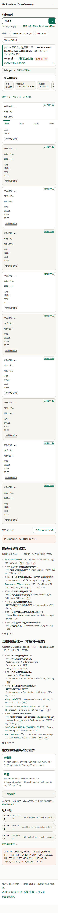
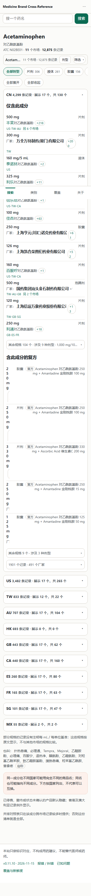

# UI 独立验收探头 · A 部分（改前基线）

> **一句话**：对 **v0.11.10** 的构建产物做独立 UI 验收，共 56 项断言，**PASS 27 / FAIL 16 / N/A 13**；结果页列序与字号已达标，仍 FAIL 的集中在「每项套边框」「胶囊徽章」「返回路径」「手机结果卡截断 / 首屏条目」四类，逐项数字见下。

| 项 | 值 |
|---|---|
| 探头 | atc4-ui（独立工位，自己量、自己复算，不从实现者口里拿结论） |
| 被测产物 | `site/dist`（mtime `2026-11-14T12:50:16-08:00`，页脚 **v0.11.10**） |
| 生成时间 | `2026-11-14T12:57:45-08:00` |
| 浏览器 | `chrome.exe`（无头 Chrome + CDP，真按 Tab 键） |
| 产物字节 / 文件 | 1,062,947,228 B |
| 原始 JSON | `reports/2026-11-15-ui-probe-before.json` |

**判定条文**：`docs/谷段需求队列.md` L1–L14 / E4 / E6 + `docs/设计原则-按人能看到的来.md` §2。每项只给 PASS / FAIL / N/A + 数字，不写主观评价；数字由本机无头 Chrome 实测，可复跑。

**为什么基线是这一版**：`site/dist` 在 2026-11-15 12:46–12:50 被一次全量构建整体替换（v0.11.9 → v0.11.10），v0.11.9 本地产物已不存在；本报告的桌面数字先在 12:41 对 v0.11.9 量过一遍，随后在**构建完成后的稳定产物 v0.11.10** 上整套重测（本文件就是这一遍），两次结果在结果页列序 / 字号 / 表格宽度上逐项一致（v0.11.9：`剂量/品牌/市场/详情`、16px/400、表宽 920px；v0.11.10 起列序变 L2 版式）。

## 0. 汇总

| 组 | 项数 | PASS | FAIL | N/A |
|---|---:|---:|---:|---:|
| 一、结果页 DOM 断言（1440×900，`/index.html?q=tylenol&lang=zh`） | 9 | 5 | 3 | 1 |
| 二、次级页 6 类页头四件套 + `<details>` + 键盘可达性（1440×900） | 27 | 9 | 6 | 12 |
| 三、首页（1440×900） | 8 | 6 | 2 | 0 |
| 四、内容带宽比（E6「桌面内容 = 视口 2/3」硬条件） | 1 | 1 | 0 | 0 |
| 五、390×844 手机 | 11 | 6 | 5 | 0 |
| **合计** | **56** | **27** | **16** | **13** |

### 0.1 全部 FAIL（16 项，给 site-ui 当验收清单）

| # | id | 项 | 数字 |
|---:|---|---|---|
| 1 | `R5` | 每行边框数（L2：不要每项套边框，靠间距与字号分层） | 前 20 行：每行带边框元素 min=8 max=10 中位=9；要求 0 |
| 2 | `R6` | 每行胶囊徽章数（L8：国家/剂型/状态不再统一做胶囊） | 前 20 行：胶囊徽章合计=24 max/行=3；`.tag/.form-tag/.badge` 共 67 个；要求 0 |
| 3 | `R7` | 按钮文案语义化（L3） | 行内按钮 41：['选择此产品', '查看登记详情', '选择此产品', '查看登记详情', '选择此产品', '查看登记详情']；页内其他按钮 55：['我用的是这条', '复制标准名', '中国泰诺林', '中国台湾ACETAMINOPHEN', '新加坡PANADOL', '美国ACETAMINOPHEN', '英国Paracetamol 500mg tablets', '加拿大ACETAMINOPHEN']；仍为旧文案=['「这条」仍作为按钮 aria-label/title']；+N 样本=[] |
| 4 | `S-drug-head` | drug 页头四件套（L7：返回路径+标题+一句话摘要+继续搜索入口） | 返回路径=无(面包屑0/返回类0) · 标题=有「Acetaminophen」 · 摘要=有「ATC N02BE01 · 11 个市场 · 12,875 条记录」 · 继续搜索=有(输入框 534×40) → 3/4 |
| 5 | `S-name-head` | name 页头四件套（L7：返回路径+标题+一句话摘要+继续搜索入口） | 返回路径=无(面包屑0/返回类0) · 标题=有「Tylenol 8 HR Arthritis Pain」 · 摘要=有「同名不代表可互换——只按登记字段做身份对应。」 · 继续搜索=有(输入框 534×40) → 3/4 |
| 6 | `S-combo-head` | combo 页头四件套（L7：返回路径+标题+一句话摘要+继续搜索入口） | 返回路径=无(面包屑0/返回类0) · 标题=有「Ferric Oxide Red + Pramoxine」 · 摘要=有「本页列出「活性成分集合恰好等于下面这组」的商品名。这里只做身份对应：复方产品」 · 继续搜索=有(输入框 534×40) → 3/4 |
| 7 | `S-maker-head` | maker 页头四件套（L7：返回路径+标题+一句话摘要+继续搜索入口） | 返回路径=无(面包屑0/返回类0) · 标题=有「Kenvue Brands LLC」 · 摘要=有「厂家 / 上市许可持有人」 · 继续搜索=有(输入框 534×40) → 3/4 |
| 8 | `S-cat-head` | cat 页头四件套（L7：返回路径+标题+一句话摘要+继续搜索入口） | 返回路径=无(面包屑0/返回类0) · 标题=有「Pain & fever relief Analgési」 · 摘要=有「全部 ATC 类别与大类」 · 继续搜索=有(输入框 700×34) → 3/4 |
| 9 | `S-coverage-head` | coverage 页头四件套（L7：返回路径+标题+一句话摘要+继续搜索入口） | 返回路径=无(面包屑0/返回类0) · 标题=有「覆盖与新鲜度」 · 摘要=有「各市场贡献什么、完整度如何、最后同步时间。计数是记录数，不是去重药品数；空白」 · 继续搜索=有,链接:检索 → 3/4 |
| 10 | `H3` | 搜索框占位文字（L1） | placeholder=「商品名 / 通用名 / 俗称 / 包装上的一行字」(24 字)；L1 要求「输入商品名、通用名或包装文字」 |
| 11 | `H7` | 更新日志位置（L1：移到页脚附近） | `.updlist` y=726px / 文档高 1096px = 66%；在 <footer> 内=False；内容=「v0.11.10 \| 2026-11-15 \| Desktop content is now the」 |
| 12 | `M2` | 结果页首屏条目数（结果页门槛 ≥5） | 选择器=#reswrap tbody tr.br 条目=0.5（可见行 1 / 总 10） 首行 top=[676] 文档高=6031px |
| 13 | `M4` | 结果页筛选入口文案（L16②：筛选 · 已选 N 项） | 含「筛选」=True 含「已选」=False；候选 10 个：['中国 泰诺林 中国台湾 ACETAMINOP', '中国 泰诺林', '中国台湾 ACETAMINOPHEN', '新加坡 PANADOL'] |
| 14 | `M9` | 结果卡内容是否被截断（L16③ 结果卡片直接纵向阅读） | 前 5 行 25 个单元格里 scrollWidth>clientWidth 的 25 个；正文带省略号 … 的 0 个；样本=[{'row': 0, 'cls': 'c-brand', 'cw': 87, 'sw': 380, 'text': 'TYLENOL FILM COATED TABLETS 500MG'}, {'row': 0, 'cls': 'c-ing', 'cw': 81, 'sw': 135, 'text': '对乙酰氨基酚'}, {'row': 0, 'cls': 'c-dose', 'cw': 81, 'sw': 187, 'text': '500 mg 片剂'}, {'row': 0, 'cls': 'c-market', 'cw': 40, 'sw': 94, 'text': 'SG 数据截止 2026-08-07'}, {'row': 0, 'cls': 'c-det', 'cw': 47, 'sw': 98, 'text': '选择此产品 查看登记详情'}, {'row': 1, 'cls': 'c-brand', 'cw': 87, 'sw': 245, 'text': 'Tylenol Extra Strength'}, {'row': 1, 'cls': 'c-ing', 'cw': 81, 'sw': 135, 'text': '对乙酰氨基酚'}, {'row': 1, 'cls': 'c-dose', 'cw': 81, 'sw': 472, 'text': '片剂 500 mg · 胶囊 500 mg · 液体 960 mg/30 mL'}] |
| 15 | `M6` | 成分页首屏条目数（内容页门槛 ≥5） | 选择器=.mkrow 条目=4.5（可见行 5 / 总 150） 首行 top=[481, 557, 654, 731, 808] 文档高=3797px |
| 16 | `M10` | 成分页「含此成分的复方」区规格列是否被压成竖排（L11/L16③） | 复方区行 5 行；宽度 ≤24px 的子元素 10 个；样本=[('mkst', 14, 5), ('mkname-cell', 14, 2), ('mkst', 14, 5), ('mkname-cell', 14, 2)]（如 250 mg 被压成 5 行竖排） |

## 一、结果页 DOM 断言（1440×900，`/index.html?q=tylenol&lang=zh`）

就绪：`ready=True`，索引稳定 `True`，`#meta` 显示完整索引（187 个名字命中），首屏渲染 20 行（默认每页 20 行）。

| 断言 | 判定 | 数字 |
|---|---|---|
| `R2` 列序：药名是否第一列（L2 目标：产品名称/成分/规格与剂型/市场/操作） | **PASS** | 实际列序=['产品名称', '成分', '规格与剂型', '市场', '操作']；第 1 列=「产品名称」 |
| `R3` 结果表含「成分」列（L2） | **PASS** | 含成分列=True；列=['产品名称', '成分', '规格与剂型', '市场', '操作']；成分只在身份卡出现：{'fs': 16, 'fw': 600, 'color': 'rgb(11, 107, 83)', 'text': '对乙酰氨基酚'} |
| `R4` 药名/规格 computed font-size·font-weight（L2：药名最大字号+较深字重） | **PASS** | 药名 17px/700；规格 16px/400；市场 16px/400；字号差=1px，字重差=300 |
| `R5` 每行边框数（L2：不要每项套边框，靠间距与字号分层） | **FAIL** | 前 20 行：每行带边框元素 min=8 max=10 中位=9；要求 0 |
| `R6` 每行胶囊徽章数（L8：国家/剂型/状态不再统一做胶囊） | **FAIL** | 前 20 行：胶囊徽章合计=24 max/行=3；`.tag/.form-tag/.badge` 共 67 个；要求 0 |
| `R7` 按钮文案语义化（L3） | **FAIL** | 行内按钮 41：['选择此产品', '查看登记详情', '选择此产品', '查看登记详情', '选择此产品', '查看登记详情']；页内其他按钮 55：['我用的是这条', '复制标准名', '中国泰诺林', '中国台湾ACETAMINOPHEN', '新加坡PANADOL', '美国ACETAMINOPHEN', '英国Paracetamol 500mg tablets', '加拿大ACETAMINOPHEN']；仍为旧文案=['「这条」仍作为按钮 aria-label/title']；+N 样本=[] |
| `R8` 1440 视口横向溢出（表格/文档） | **PASS** | document.scrollWidth=1440 vs innerWidth=1440；table scrollW/clientW=920/920（差 0px）；表格实宽=920px；#reswrap overflow-x=auto |
| `R9` 首屏（1440×900）内容构成（L6 基线） | N/A | 首条结果 top=645px / 视口 900px；身份卡 bottom=362px；工具条/提示层 4 个 |

**逐行明细（前 20 行）**：

| 行 | 1 | 2 | 3 | 4 | 5 | 6 | 7 | 8 | 9 | 10 | 11 | 12 | 13 | 14 | 15 | 16 | 17 | 18 | 19 | 20 |
|---|---|---|---|---|---|---|---|---|---|---|---|---|---|---|---|---|---|---|---|---|
| 带边框元素数 | 8 | 9 | 9 | 10 | 9 | 9 | 9 | 10 | 8 | 10 | 10 | 8 | 8 | 10 | 9 | 9 | 9 | 9 | 10 | 10 |
| 胶囊徽章数 | 1 | 3 | 1 | 2 | 1 | 2 | 1 | 1 | 1 | 1 | 1 | 1 | 1 | 1 | 1 | 1 | 1 | 1 | 1 | 1 |

**按钮文案实测**（L3 四句对照）：

| L3 要求 | 实测 |
|---|---|
| 行内「这条」→「选择此产品」 | 行内按钮文案已是 `选择此产品` / `查看登记详情`；但 `pickbtn` 仍带 `title="这条" aria-label="这条"`（屏幕阅读器仍读「这条」）|
| 「详情」→「查看登记详情」 | 已改 |
| 「逐项对照」→「与目标市场产品对照」 | 本轮实测 0 处 `逐项对照` |
| 「+218」→「查看其余 N 个产品」 | 已改（实测「查看其余 10 个产品」） |
| 另一处 0 号按钮 | 身份卡动作仍是 **「我用的是这条」**（含「这条」二字）|

## 二、次级页 6 类页头四件套（L7）+ `<details>` + 键盘可达性（1440×900）

四件套 = **返回路径 / 页面标题 / 一句话摘要 / 继续搜索入口**。

| 页 | 返回路径 | 标题 | 一句话摘要 | 继续搜索入口 | 四件套 | `<details>` | 带宽比 |
|---|---|---|---|---|---|---:|---:|
| `drug` | **无** | 有 | 有 | 有 | **3/4** | 92 | 0.667 |
| `name` | **无** | 有 | 有 | 有 | **3/4** | 5 | 0.667 |
| `combo` | **无** | 有 | 有 | 有 | **3/4** | 5 | 0.667 |
| `maker` | **无** | 有 | 有 | 有 | **3/4** | 5 | 0.667 |
| `cat` | **无** | 有 | 有 | 有 | **3/4** | 209 | 0.667 |
| `coverage` | **无** | 有 | 有 | 有 | **3/4** | 5 | 0.667 |

**返回路径细节**：6 个页型的面包屑链接数、`rel=up`、「返回」类按钮**全部为 0**——页头没有从「当前页 → 上级/首页」的可点路径，只有全站导航「检索 / 按类别 / 覆盖 / 关于」。

**页头四件套实测文本**：

| 页 | `<h1>` | 一句话摘要（实测原文，截断） | 继续搜索入口 |
|---|---|---|---|
| `drug` | Acetaminophen | ATC N02BE01 · 11 个市场 · 12,875 条记录 | 输入框 534×40 |
| `name` | Tylenol 8 HR Arthritis Pain | 同名不代表可互换——只按登记字段做身份对应。 | 输入框 534×40 |
| `combo` | Ferric Oxide Red + Pramoxine + Zinc Oxid | 本页列出「活性成分集合恰好等于下面这组」的商品名。这里只做身份对应：复方产品≠各单方成分的简单相加，同名商品在不同市场也 | 输入框 534×40 |
| `maker` | Kenvue Brands LLC | 厂家 / 上市许可持有人 | 输入框 534×40 |
| `cat` | Pain & fever relief Analgésicos y antité | 全部 ATC 类别与大类 | 输入框 700×34 |
| `coverage` | 覆盖与新鲜度 | 各市场贡献什么、完整度如何、最后同步时间。计数是记录数，不是去重药品数；空白或 0% 表示来源不提供该字段。 | 链接：检索 |

**键盘可达性（真按 Tab，不是查 tabindex）**：

| 页 | 落点 | 有名 | 去重 | 含检索入口 | 第 14 个落点在 main 内 | 前 8 个落点 |
|---|---:|---:|---:|---|---|---|
| `drug` | 14 | 13 | 14 | 是 | 是 | 跳到主要内容 / Medicine Brand / 检索 / 按类别 / 按市场 / 覆盖与新鲜度 / 关于 / input |
| `maker` | 14 | 13 | 14 | 是 | 是 | 跳到主要内容 / Medicine Brand / 检索 / 按类别 / 按市场 / 覆盖与新鲜度 / 关于 / input |
| `coverage` | 14 | 13 | 14 | 是 | 否 | 跳到主要内容 / Medicine Brand / 检索 / 按类别 / 按市场 / 覆盖与新鲜度 / 关于 / input |

> 说明：三页前 14 个落点都是同一串「跳到主要内容 → Logo → 检索 → 按类别 → 按市场 → 覆盖与新鲜度 → 关于 → 搜索框」，**没有焦点样式丢失**（逐个记录 `outline` 均为浏览器默认值），但也说明**页头四件套里的「返回路径」没有任何键盘入口**。

## 三、首页（1440×900）

| 断言 | 判定 | 数字 |
|---|---|---|
| `H1` 搜索框是唯一视觉中心（L1） | **PASS** | #q 920×50 @y=239（视口 1440×900，上缘 27%）· 搜索框(+按钮)面积占比 3.8% · 首屏输入框 4 个 ['bilOrig', 'q', 'country', 'src'] · 搜索框下方 ≥24px 竞争标题 0 个 [] |
| `H2` 搜索按钮显示「搜索」文字（E2/L1） | **PASS** | #qgo 文案=「搜索→」(79×44, fs=15px)；要求「搜索」 |
| `H3` 搜索框占位文字（L1） | **FAIL** | placeholder=「商品名 / 通用名 / 俗称 / 包装上的一行字」(24 字)；L1 要求「输入商品名、通用名或包装文字」 |
| `H4` 可点击查询示例（L1 要求 3 个） | **PASS** | 可点击示例 3 个：['Tylenol Extra Strength', 'Metformin', '960 mg/30 mL']；`.u1try` 容器 3 个；三步教学步骤 3 个（L1 要求压成一句 +「怎么用」展开） |
| `H5` 类别卡片尺寸统一（L1） | **PASS** | 9 张卡：宽集合=[208] 高集合=[44]（L1 写 8 入口，实测 9） |
| `H6` 「core 约 42 MB / gzip / 检索分片」技术说明已移出首页（E4） | **PASS** | 可见文字命中 0 处：[] |
| `H7` 更新日志位置（L1：移到页脚附近） | **FAIL** | `.updlist` y=726px / 文档高 1096px = 66%；在 <footer> 内=False；内容=「v0.11.10 \| 2026-11-15 \| Desktop content is now the」 |
| `H8` 内容带宽比 @1440（E6 硬条件 0.652–0.682，口径=main 子块并集） | **PASS** | main 子块并集 960px / 1440px = 0.667（x 240–1200）；`.wrap`=960px x=240 → 0.667 |

**可点击示例实测（可见）**：`Tylenol Extra Strength`、`Metformin`、`960 mg/30 mL`。

**更新日志位置口径**：`.updlist` 上缘 `726px` / document 高 `1096px` = `0.662`，`closest('footer')` = `False`。按「在 `<footer>` 内」的严格口径判 FAIL；若按「主内容最后一块」的宽松口径则可算达标——两种读法数字都在上面，由 Lead 定口径。

**顺带记录（同一行的语言）**：`最近更新` 第一条的一句话变化实测为英文原文 「`Desktop content is now the middle two-t……`」，出现在 `lang=zh` 页面上 → `data/release_notes_i18n.json` 缺 v0.11.10 的 zh 译文（E5 的「一句话变化」有，语言不对）。

## 四、内容带宽比（E6：桌面内容 = 视口 2/3，0.652–0.682）

| 页型 | 1440 | 1920 | 2560 |
|---|---:|---:|---:|
| 首页 | 0.667 (PASS) | 0.667 (PASS) | 0.656 (PASS) |
| 成分页 | 0.667 (PASS) | 0.667 (PASS) | 0.656 (PASS) |
| 覆盖页 | 0.667 (PASS) | 0.667 (PASS) | 0.656 (PASS) |
| ATC 类目页 | — | 0.667 (PASS) | 0.656 (PASS) |

> 口径：`main` 直接子块在首屏内可见矩形的 x 并集 ÷ 视口宽；结论与首屏守卫 `band_ratio` 一致（护栏容差 ±0.015，2560 因 `max-width` 上限取 0.656）。

## 五、390×844 手机

| 断言 | 判定 | 数字 |
|---|---|---|
| `M1` 390×844 结果页就绪 | **PASS** | ready=True |
| `M2` 结果页首屏条目数（结果页门槛 ≥5） | **FAIL** | 选择器=#reswrap tbody tr.br 条目=0.5（可见行 1 / 总 10） 首行 top=[676] 文档高=6031px |
| `M3` 结果页搜索框首屏可见（L16①） | **PASS** | #q 362×46 @y=115；在首屏=True |
| `M4` 结果页筛选入口文案（L16②：筛选 · 已选 N 项） | **FAIL** | 含「筛选」=True 含「已选」=False；候选 10 个：['中国 泰诺林 中国台湾 ACETAMINOP', '中国 泰诺林', '中国台湾 ACETAMINOPHEN', '新加坡 PANADOL'] |
| `M9` 结果卡内容是否被截断（L16③ 结果卡片直接纵向阅读） | **FAIL** | 前 5 行 25 个单元格里 scrollWidth>clientWidth 的 25 个；正文带省略号 … 的 0 个；样本=[{'row': 0, 'cls': 'c-brand', 'cw': 87, 'sw': 380, 'text': 'TYLENOL FILM COATED TABLETS 500MG'}, {'row': 0, 'cls': 'c-ing', 'cw': 81, 'sw': 135, 'text': '对乙酰氨基酚'}, {'row': 0, 'cls': 'c-dose', 'cw': 81, 'sw': 187, 'text': '500 mg 片剂'}, {'row': 0, 'cls': 'c-market', 'cw': 40, 'sw': 94, 'text': 'SG 数据截止 2026-08-07'}, {'row': 0, 'cls': 'c-det', 'cw': 47, 'sw': 98, 'text': '选择此产品 查看登记详情'}, {'row': 1, 'cls': 'c-brand', 'cw': 87, 'sw': 245, 'text': 'Tylenol Extra Strength'}, {'row': 1, 'cls': 'c-ing', 'cw': 81, 'sw': 135, 'text': '对乙酰氨基酚'}, {'row': 1, 'cls': 'c-dose', 'cw': 81, 'sw': 472, 'text': '片剂 500 mg · 胶囊 500 mg · 液体 960 mg/30 mL'}] |
| `M5` 390×844 成分页就绪 | **PASS** | ready=True |
| `M6` 成分页首屏条目数（内容页门槛 ≥5） | **FAIL** | 选择器=.mkrow 条目=4.5（可见行 5 / 总 150） 首行 top=[481, 557, 654, 731, 808] 文档高=3797px |
| `M7` 成分页搜索框首屏可见（L16①） | **PASS** | #q=有；在首屏=True；首屏输入框 2 个 ['hq', 'lf-spec'] |
| `M8` 成分页筛选入口文案（L16②） | **PASS** | 筛选/折叠控件 99 个；含「筛选」=True；前几个=['⋯', '筛选', '全部剂型 片剂 306 液体 261 胶囊 15', '全部剂型'] |
| `M10` 成分页「含此成分的复方」区规格列是否被压成竖排（L11/L16③） | **FAIL** | 复方区行 5 行；宽度 ≤24px 的子元素 10 个；样本=[('mkst', 14, 5), ('mkname-cell', 14, 2), ('mkst', 14, 5), ('mkname-cell', 14, 2)]（如 250 mg 被压成 5 行竖排） |
| `M11` 成分页「+N」徽章是否溢出所在卡片（L8） | **PASS** | 溢出徽章 0 个；样本=[] |

**截图（全页，390×844，v0.11.10 产物）**：

- `docs/img/ui-probe-before-results-390x844.png` — `index.html?q=tylenol&lang=zh`；文档高 `6031px`，截图高 `6031px`（截断=False）
- `docs/img/ui-probe-before-drug-390x844.png` — `drug/acetaminophen.html`；文档高 `3797px`，截图高 `3797px`（截断=False）





**结果卡截断明细（前 5 行，`scrollWidth` 对比 `clientWidth`）**：

| 单元格 | 可用宽 | 内容宽 | 文本 |
|---|---:|---:|---|
| `.c-brand` | 87px | 380px | TYLENOL FILM COATED TABLETS 500MG |
| `.c-ing` | 81px | 135px | 对乙酰氨基酚 |
| `.c-dose` | 81px | 187px | 500 mg 片剂 |
| `.c-market` | 40px | 94px | SG 数据截止 2026-08-07 |
| `.c-det` | 47px | 98px | 选择此产品 查看登记详情 |

**复方区窄列明细**：

| 元素 | 宽 | 行数 | 文本 |
|---|---:|---:|---|
| `.mkst` | 14px | 5 行 | 250 mg |
| `.mkname-cell` | 14px | 2 行 | 厂家： 修正药业集团股份有限公司 ×9 +33 |
| `.mkst` | 14px | 5 行 | 250 mg |
| `.mkname-cell` | 14px | 2 行 | 厂家： 上海寿如松药业泌阳制药有限公司 ×7 +12 |

## 六、7 指标（`deploy/first_screen_check.py`，390 / 768 两档，同一份 v0.11.10 产物）

这一节是**本探头自己跑官方首屏守卫**得到的数字（不是抄别人的报告），口径 `afcr-band-v2`。

| 页型 | 视口 | AFCR | 首屏条目 | chrome | 悬浮 | 正文 px | 辅助 px | 横向溢出 | 未达项 |
|---|---|---:|---:|---:|---:|---:|---:|---|---|
| home | 390x844 | 0.93 | 0 | 0.135 | 0.068 | 16 | 14 | 无 | — |
| home | 768x1024 | 1.005 | 9 | 0.105 | 0.0 | 16 | 14 | 无 | — |
| results | 390x844 | 0.88 | 0.5 | 0.182 | 0.068 | 16 | 13 | 无 | **items** |
| results | 768x1024 | 0.912 | 3 | 0.189 | 0.0 | 16 | 13 | 无 | — |
| drug | 390x844 | 0.921 | 4.5 | 0.206 | 0.068 | 16 | 13 | 无 | **items** |
| drug | 768x1024 | 1.0 | 8 | 0.17 | 0.0 | 16 | 13 | 无 | — |
| name | 390x844 | 1.001 | 1 | 0.398 | 0.068 | 16 | 14 | 无 | **chrome_ratio** |
| name | 768x1024 | 1.0 | 1 | 0.287 | 0.0 | 16 | 14 | 无 | — |
| atc | 390x844 | 0.93 | 7.5 | 0.135 | 0.068 | 16 | 13 | 无 | — |
| atc | 768x1024 | 1.005 | 15 | 0.105 | 0.0 | 16 | 13 | 无 | — |
| coverage | 390x844 | 0.787 | 1.5 | 0.269 | 0.068 | 16 | 14 | 无 | **items** |
| coverage | 768x1024 | 0.912 | 4.5 | 0.189 | 0.0 | 16 | 14 | 无 | **items** |

共 12 次扫描，**未达标 5 组**。（阈值：内容页 AFCR ≥0.50 / 结果页 ≥0.35 / 入口页 ≥0.30；结果页首屏条目 ≥5；内容页 chrome ≤0.35 / 结果页 ≤0.40；正文 ≥16px、辅助 ≥13px；横向溢出 0。）

守卫截图 12 张：`.tmp/ui-probe/fs-shots/`（证据目录，不长期留档）。

## 七、与另一路守卫的交叉核对（不是同一份数字来源，只作对照）

`deploy/first_screen_check.py`（首屏守卫，另一路探头，2026-11-15 12:37 对 **v0.11.9** 产物跑）留档在 `.tmp/first-screen/before-20261115.json`，与本次对 v0.11.10 的独立测量对照：

| 指标 | 守卫 v0.11.9 | 本探头 v0.11.10 | 说明 |
|---|---|---|---|
| 结果页 @390 首屏条目 | 0.5 | 0.5 | 一致，两版都 <5 |
| 成分页 @390 首屏条目 | 5.0 | 4.5 | **v0.11.10 的 K1 折叠后少 0.5 条**（门槛 5）|
| 成分页 @390 文档高 | 20,305px | 3,797px | K1 折叠生效（−81%）|
| 结果页 @390 文档高 | 2,223px | 6,031px | 结果表换 5 列 L2 版式后变高 2.7× |
| 结果页 @1440 首条结果上缘 | — | 645px（v0.11.9 为 806px） | L2/身份卡压缩后提前 161px |
| 首页 @1440 带宽比 | 1.00（FAIL）| 0.667（PASS）| E6 已修 |

## 八、复现

```powershell
$py = 'C:\Users\asus\.dsh\dsh-runtimes\dsh-primary-runtime\dependencies\python\python.exe'
& $py .tmp/ui-probe/probe.py --out reports/2026-11-15-ui-probe-before.json   # 对 site/dist 实测
& $py .tmp/ui-probe/render_md.py                                            # JSON → 本报告
```

- 探头只读：不写 `site/build.py`、不写 `site/dist`、不 commit、不发布；写权限仅 `reports/`、`docs/img/`、`.tmp/ui-probe/`。
- 每次导航都等 `document.readyState=complete` + 页面自带的就绪条件；结果页额外等「完整索引」（`#meta` 不再含「部分结果/正在加载」）再量，避免拿半份索引当基线。
- 已知限制：①无头 Chrome 无系统字体/滚动条差异，几何量有 ±8px 级误差；②结果页样本是单查询 `q=tylenol`，换查询条目数会变；③`每行边框数`按「行内 computed border-width>0 的元素个数」计数，含 `tr/td/td 内子元素`。

_本文件由 `.tmp/ui-probe/render_md.py` 从 `reports/2026-11-15-ui-probe-before.json` 生成；56 项断言，PASS 27 / FAIL 16 / N/A 13。_
