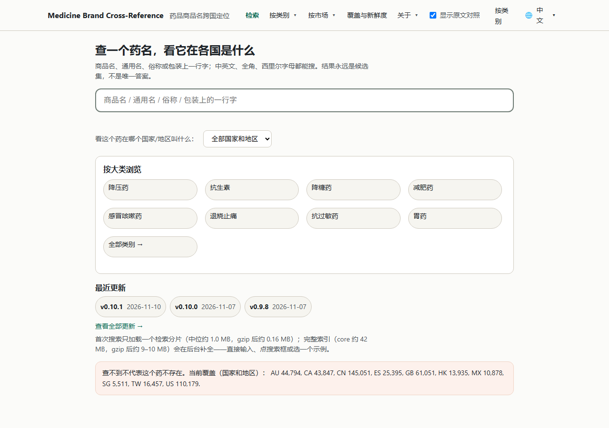
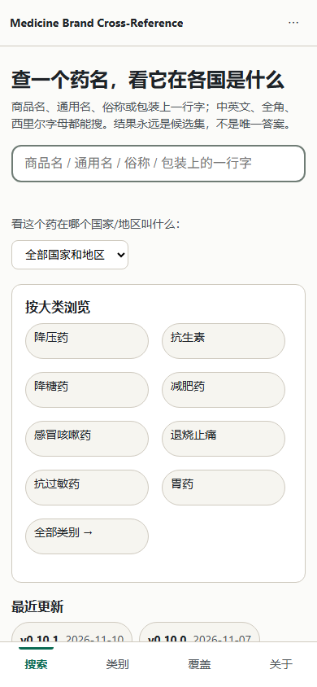
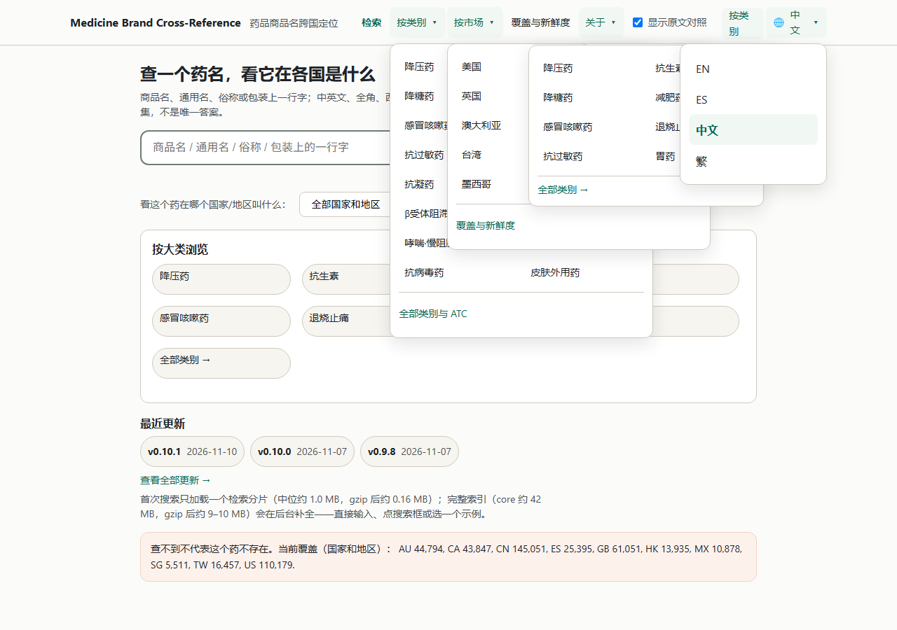
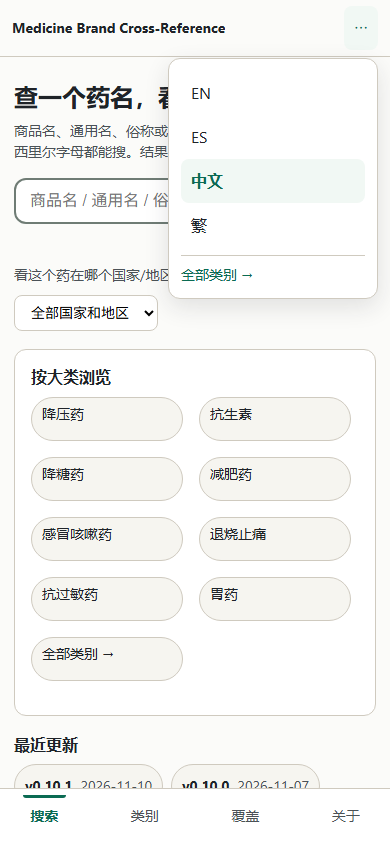
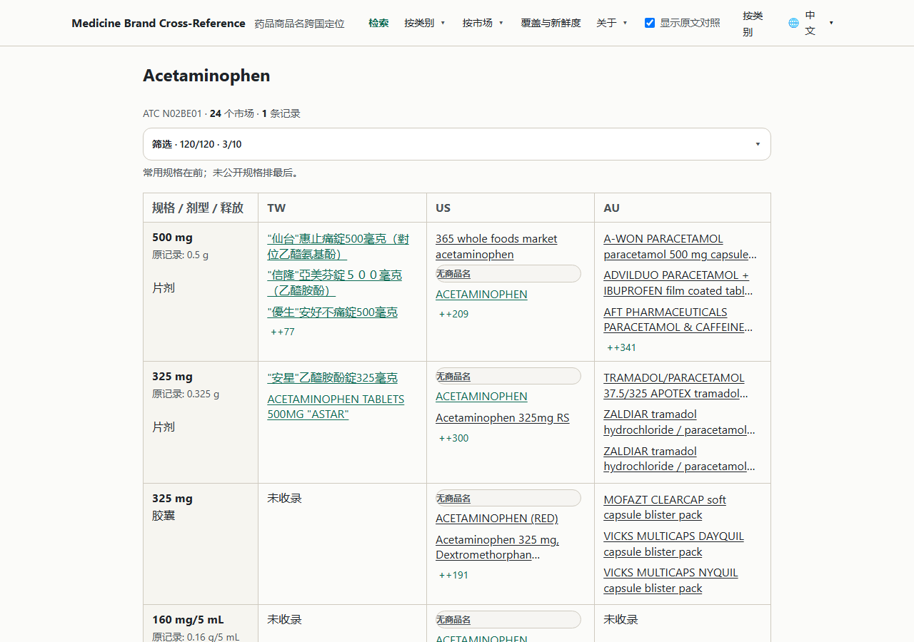
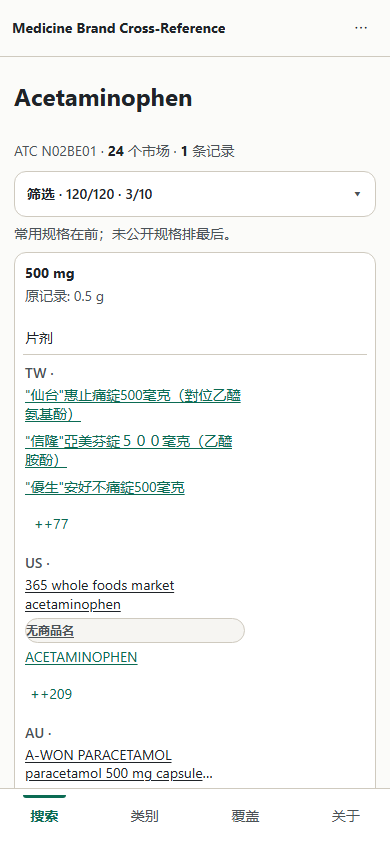
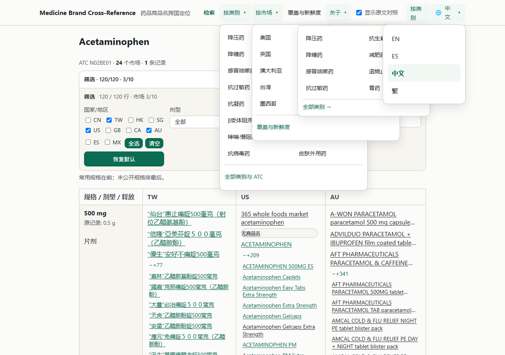
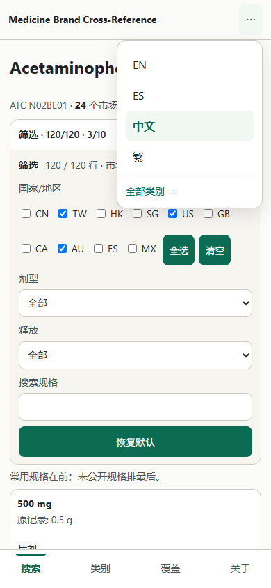

# v0.10.2 同色守卫（UI surface）— 2026-11-10

## 结论

用户 2026-11-10 硬规则：**「框内颜色和框外颜色不许能一致」**。任何嵌套表面（面板里的输入框、
下拉面板、卡片里的筛选区、chip、次要按钮）的填充色不许等于它所在容器的填充色，只靠 0.8px
边框区分不算合格。

- **违规实测 43 处 → 补丁后 0 处**（6 页 × 2 视口，真 Chrome，`deploy/ui_surface_check.py`）。
- 根因是同一种写法错误：`.sn-panel` / `.idacts` / `.matrix-filters` / `#q` / `#country` / `#ac`
  全都写死 `#fff`，而它们的容器也是 `#fff`；`.catchip` 与 `.catquick` 则是同一个 `#f6f5f0`
  （`--band` 与 `--surface-2` 同值），chip 连边框都只剩 1px 在撑。
- 修法**不新增色值**：只用现有的 `--bg / --card / --surface-2 / --line` 摆成三层交替，
  外加补上一条**早就被引用、但从未定义**的 `--accent-weak`。
- **补丁已就绪但还没落地**：`docs/patch-v0102-ui-surface.diff`（9 增 6 删），
  `git apply --check` 通过；`site/build.py` 本身**未改动**（另一个会话在收尾，避免互相踩）。
  下文所有「补丁后」数据都是在**预览模式**（同一份产物 + 打了补丁的 CSS）实测的，
  正式复验要等 apply + 全量构建后再跑一次不带 `--override` 的守卫。

| 项 | 数值 |
|---|---|
| 扫描覆盖 | 6 页 × 2 视口 = 12 次；单次遍历 DOM 元素 241–6,800 个 |
| 补丁前同色 | **43 处**（12 种「选择器 × 容器」组合） |
| 补丁后同色 | **0 处** |
| 守卫耗时 | 25–35 秒（含拉起无头 Chrome） |
| 退出码 | 有违规 = 1，干净 / SKIP = 0 |

## 1. 违规前后对照表

「尺寸」= 该元素在实测视口下的 `getBoundingClientRect()`，`×n` = 同一组合出现次数。

| # | 元素 | 自身填充 | 容器（最近不透明祖先） | 容器填充 | 尺寸 | 视口 | 补丁后 |
|---|---|---|---|---|---|---|---|
| 1 | `div.sn-panel`（导航下拉） | `#fff` | `header.hdr-shell` | `#fff` | 376×421 ×3 | 桌面 | 容器降到 `--bg` ✅ |
| 2 | `div.sn-panel-right`（类别/语言下拉） | `#fff` | `header.hdr-shell` | `#fff` | 336×231 ×2 / 210×241 ×1 | 桌面 / 手机 | 同上 ✅ |
| 3 | `a.catchip`（按大类浏览 8 个） | `#f6f5f0` | `section.catquick` | `#f6f5f0` | 198×44 / 152×44 | 双端 | 容器升到 `--card` ✅ |
| 4 | `a.catchip-all`（全部类别） | `#f6f5f0` | `section.catquick` | `#f6f5f0` | 198×44 / 152×44 | 双端 | 同上 ✅ |
| 5 | `.idcard a`（复制标准名） | `#fff` | `section.idcard` | `#fff` | 116×40 | 双端 | 按钮降到 `--surface-2` ✅ |
| 6 | `.idcard button`（报告这个结果） | `#fff` | `section.idcard` | `#fff` | 102×40 | 双端 | 同上 ✅ |
| 7 | `section.matrix-filters`（成分页筛选区） | `#fff` | `details.mf-details` | `#fff` | 878×208 / 360×450 | 双端 | 降到 `--surface-2` ✅ |
| 8 | `.matrix-filters select` | `#fff` | `section.matrix-filters` | `#fff` | 203×32 / 336×40 ×2 | 双端 | 槽变浅灰，控件留白 ✅ |
| 9 | `.matrix-filters input[type=search]` | `#fff` | `section.matrix-filters` | `#fff` | 203×30 / 336×40 | 双端 | 同上 ✅ |
| 10 | `input#q`（手机粘性搜索条里） | `#fff` | `div.searchwrap` | `#fff` | 362×46 | 手机 | 粘性条降到 `--bg` ✅ |
| 11 | `select#country`（手机粘性条里） | `#fff` | `div.searchwrap` | `#fff` | 144×36 | 手机 | 同上 ✅ |
| 12 | `div#ac`（自动完成下拉）**※清单外** | `#fff` | `div.searchwrap` | `#fff` | 362×339 | 手机 | 同上 ✅ |

按页面统计（补丁前，桌面 / 手机）：首页 6 / 7、结果页 6 / 6、成分页 5 / 4、名字页 2 / 1、
ATC 页 2 / 1、coverage 2 / 1 = **43**。

**清单外新发现 3 处**（用户给的 6 行基线里没有）：

1. `select#country`——手机粘性搜索条里的「全部国家和地区」，和 `input#q` 同色，破了同一条规则；
2. `div#ac`——**自动完成下拉**（`#ac`）在手机结果页同样是白压白。要真正看到它必须先输入 ≥2 字
   （`build.py` 里「输入 ≥2 字，top 8」），一开始用 1 个字符探不到，改成 `at` 才唤起；
3. `.idcard` 里其实是**两个**元素（`a` 复制标准名 116×40 + `button` 报告这个结果 102×40），
   基线只写了 button。

**没在清单里、但实测不违规**（同样是用户点名要问的）：表格斑马行
（`table.res tbody tr:nth-child(even)` = `--surface-2`，祖先落在页面 `--bg`，不同色）、
`table.matrix td.m-spec`、`.u2chip`（浅灰 chip 在白色 `.u2bar` 里）、`.u1step`（浅灰步卡在白色引导卡里）、
`.warnfilters button` / `.covtools button`（白按钮在浅灰 `.section` 里）、`.tabbar`（手机底栏
用 `--card` 白 + 1px 上边框压在页面 `--bg` 上，本来就不与页面同色，守卫另把 `header` / `.tabbar`
记为「页面层」，只与自己的容器比、不与页面画布比）。
站点**没有 modal / tooltip**：`#ac` 自动完成是唯一的浮层，已覆盖。

## 2. 色阶层级（只用现有 token，不新增色值）

| 层 | token | 值 | 用在 |
|---|---|---|---|
| 1 页面 / 页头 chrome | `--bg` | `#fbfbf9` | `body`、`header.hdr-shell`、手机粘性 `.searchwrap` |
| 2 卡片 / 面板 | `--card` | `#fff` | `.card`、`.idcard`、`.u1guide`、`.mf-details`、`.sn-panel`、`.catquick`（改后）、`#q` / `select` 等输入控件 |
| 3 卡片内的井 / 槽 | `--surface-2` | `#f6f5f0` | `.matrix-filters`（改后）、`.catchip`、`.idacts` 次要按钮（改后）、`.u2chip`、`.u1step`、表头行 |
| 4 槽里的控件 | `--card` + 1px `--line` | `#fff` | `.mf-field select`、`.mf-field input`、`.m-reset` |

规则就一句：**相邻两层绝不同色**。`--band` 与 `--surface-2` 同值（`#f6f5f0`），所以「浅灰面板里
再放浅灰 chip」必然违规——这正是 `.catquick` + `.catchip` 那 9 个 chip 的病根。

`header` 与页面同色后，靠原有的 `border-bottom:1px solid var(--line)` 分界（实测 1280 / 390
都好认，见截图）；`header` 上的白色下拉 `.sn-panel`（自带 `box-shadow:0 8px 24px`）因此立刻浮起来。
`.tabbar`（手机底栏）故意留在 `--card`：它是浮在页面之上的 chrome，不是被页面包住的表面。

### 补丁改了哪 7 处（`docs/patch-v0102-ui-surface.diff`）

```diff
 :root{... --accent:#0b6b53;--accent-weak:#f1f8f4; ...}          +  补上未定义 token
-header{...background:#fff}            → background:var(--bg)     页头降到第 1 层
-.idacts a,.idacts button{...#fff...}  → var(--surface-2)         身份卡按钮降到第 3 层
-.has-q .searchwrap{...background:#fff} → var(--bg)               手机粘性条降到第 1 层
-.matrix-filters{...background:#fff}   → var(--surface-2)         筛选区降到第 3 层
-.mf-details .matrix-filters{border-radius:0} → 0 0 12px 12px     井铺满时补回下方圆角
+main .catquick{background:var(--card)}                           大类面板升到第 2 层
```

`--accent-weak` 原来在 `.sn-right details[open]>summary` 和 `.lang-menu a.on` 里被引用却从未定义，
CSS 变量解析失败 → 那两处背景实际是 `transparent`（选中项只剩文字色区分）。补上 `#f1f8f4`
（与 `.sn>a:hover` / `.u2chip.on` 同一个浅绿）后，语言菜单的当前项才有底色。

## 3. 守卫脚本用法

```powershell
$py = 'C:\Users\asus\.dsh\dsh-runtimes\dsh-primary-runtime\dependencies\python\python.exe'

# 扫构建产物（脚本自带只读静态服务，随机端口；不写任何被服务的文件）
& $py deploy/ui_surface_check.py --dist site/dist --json .tmp/ui-surface/after.json

# 扫已起的服务
& $py deploy/ui_surface_check.py --base-url http://127.0.0.1:8000/

# 白名单（默认空）：每行一条正则，匹配「元素选择器」或「容器选择器」
& $py deploy/ui_surface_check.py --allow .tmp/ui-surface/allow.txt

# 留证截图（首页 + 成分页 × 两视口，干净态 + 展开态各一张）
& $py deploy/ui_surface_check.py --dist site/dist --shots docs/img --shot-prefix ui-surface

# 预览补丁（只为验证补丁，不替代全量构建；正式验收不要带）
& $py deploy/ui_surface_check.py --dist .tmp/dist-v0102 `
    --override assets/style.css=.tmp/ui-surface/style-after.css `
    --override index.html=.tmp/ui-surface/index-after.html
```

判定口径（都写进脚本注释了）：

- 遍历 `body *`，跳过 `display:none` / `visibility:hidden` / 有效透明度 ≤ 0 / 面积 < 8×8；
- 取自身 `background-color`，alpha < 0.5 视为「没有填充」；
- 向上找最近的**不透明**祖先填充色；`html/body` 是页面画布不是容器，到它就停；
- RGB 相同即违规（`#fff` 与 `rgb(255,255,255)` 视为同色）；
- 页头 / 底栏（`header`、`.tabbar`）按「页面层」处理：它们本身就是页面 chrome，只与自己的容器
  比色、不与页面画布比（`header` 改后正好等于 `--bg`，这是设计层第 1 层，不算违规）；
- 每个视口扫两遍：先展开全部 `<details>` / `.mf-open`（否则下拉面板、筛选面板是 `display:none`，
  扫不到），再输 2 个字符唤起 `#ac` 自动完成再扫一遍；
- 每轮用**全新** Chrome 用户目录（临时目录，跑完删掉）+ 清 localStorage，保证前后两次的 DOM 一致
  （否则首屏 3 步引导的打开/关闭会让元素数从 667 跳到 790，前后就不可比了）。

退出码：0 = 无违规 / SKIP，1 = 有违规。找不到本机 Chrome（注册表 → PATH → 常见安装路径都试过）
或产物目录不存在时打印 `[SKIP]` 并返回 0。

### 接进 `deploy/ci_checks.py`

- 新增 `check_ui_surface()`（第 6 项，`check_workflow` 顺延为第 7 项）；
- **只在全量模式跑**，`--fast` 下记 `[SKIP] ui-surface --fast 跳过（要拉无头 Chrome，全量才跑）`；
- 无 Chrome / 无 `site/dist` 时也 SKIP，不会把 CI 拉红；
- 明细落 `.tmp/ui-surface/ci.json`。

实测：`--fast` 79.1s，`ui-surface` 一项 SKIP；全量里这一项 24.8s（对当前 `site/dist` 报 43 处，
因为 `site/dist` 还是 v0.10.1 的产物——**这说明守卫真的在拦，不是空跑**）。

## 4. 截图（`docs/img/`）

| 页面 | 桌面 1280×900 | 手机 390×844 |
|---|---|---|
| 首页（干净态） |  |  |
| 首页（展开态：导航下拉 + 语言菜单） |  |  |
| 成分页（干净态） |  |  |
| 成分页（展开态：筛选面板） |  |  |

看图要点：首页「按大类浏览」现在是**白卡 + 浅灰 chip**（原来是浅灰面板 + 同色 chip，chip 只靠
1px 边框才看得出是药丸）；成分页「筛选」展开后是**白卡里一块浅灰井**，井里的下拉/输入框是白的
（原来井和卡都是白的、`border:0`，整块边界不存在）；导航下拉是白面板浮在米色页头上。

## 5. 首屏字节（四语首页）

四语首页（`index.html`、`zh/`、`es/`、`zh-hant/`）都把 CSS **内联**（`_optimize_home_html()`
去注释 + 压空白），所以要看内联块的变化：

| 项 | 补丁前 | 补丁后 | Δ |
|---|---:|---:|---:|
| 内联 CSS raw | 33,197 B | 33,303 B | **+106 B** |
| 内联 CSS gzip | 6,998 B | 7,034 B | **+36 B** |
| `assets/style.css` raw | 38,604 B | 38,892 B | +288 B |
| `assets/style.css` gzip | 10,083 B | 10,225 B | +142 B |

- 预算：首屏 ≤ 330 KB raw / ≤ 110 KB gz，实测基线 311 KB raw / 104 KB gz → 余量约 19 KB。
  **+106 B（0.03%）不构成问题**，但确实不是零，按要求报上来。
- 涨的是「引用 token 比写 `#fff` 长」（`var(--surface-2)` 16 字符 vs `#fff` 4 字符）
  + 新增的 `--accent-weak`（22 B）+ `main .catquick{...}`（40 B）。
  如果一定要字节零增长，把那几条改回字面色值可省约 50 B，但会丢掉「层级用 token 表达」的可读性，
  不推荐。
- 页面注释不进内联块（被 `/*...*/` 正则剥掉），只影响 `style.css`，所以注释写在补丁里不占首屏。
- **遗留**：apply + 全量构建后要按四语各量一次首屏（`data/idx/core.json` 与 i18n 都不受影响，
  预期只有上面的 CSS 增量），命令：
  `& $py deploy/ci_checks.py --fast` + `docs/网站优化流程.md` §4 的体积项。

## 6. 落地步骤（等人点头）

```powershell
# 1) 打补丁（先确认没有别的会话在改 site/build.py）
& .\tools\git\cmd\git.exe apply --check docs\patch-v0102-ui-surface.diff   # exit 0
& .\tools\git\cmd\git.exe apply         docs\patch-v0102-ui-surface.diff

# 2) 全量重建到 == done ==
& $py site/build.py

# 3) 复验（这次不带 --override，扫真实产物）
& $py deploy/ui_surface_check.py --dist site/dist --json .tmp/ui-surface/after-build.json --shots docs/img

# 4) 全量 CI（守卫会自己跑）
& $py deploy/ci_checks.py
```

## 7. 遗留 / 未做

1. **补丁未落地**：`site/build.py` 没动，`docs/patch-v0102-ui-surface.diff` 等确认。
   落地前必须确认没有其他会话在写 `site/build.py`（12:46 时它刚被改过）。
2. **`deploy/ci_checks.py` 可能被并发改过**：我读它时是 254 行、无 i18n 检查；动手时已经是 294 行、
   多了 `check_i18n()`。我的改动是在那份新版本之上追加的（第 6 项 + `main()` 两行），
   如果另一会话随后整文件重写，这两处需要重新贴一次。
3. **`ci_checks.py --fast` 现在不是全绿**，但**不是本改动引起的**：
   `[FAIL] i18n  release-latest-missing: 最新版 v0.10.1（2026-11-10）在 release_notes_i18n.json
   里没有译文`——这是另一会话新加的 i18n 检查，我改之前就在红。`ui-surface` 在 `--fast` 下 SKIP，
   与本项无关。
4. **守卫只覆盖 6 个页面**。12 万长尾页共用同一份 CSS，理论上等价；但 `.drug-name-src` 徽章、
   `table.det`（明细表 `#f6f5f0`，如果将来嵌进同样浅灰的行会撞色）、`.grp` 行这些只在特定数据下
   出现的组合没有逐一枚举。要扩面就加 `PAGES`，脚本本身不用改。
5. **`#ac` 自动完成在首页有时不展开**（`ac_state=CLOSED`，索引还在异步加载）。结果页两视口都稳定
   `OPEN`，所以这一处是覆盖到的；首页那条属于探针时序，不影响结论。
6. 顺带发现（**本次未改**）：`#ac` 的 `.ac-item` 分隔线写死 `#f1efe9`、`.res-skeleton` 的渐变写死
   `#f1efe9/#f8f6f1`、`.catchip` 与 `.u2chip` / `.u1step` 仍写字面 `#f6f5f0`——都和 `--surface-2`
   同值，等价但不走 token；不属于本次同色问题，留给下一次 token 收敛。

## 8. 复现命令（本次实测）

```powershell
$py = 'C:\Users\asus\.dsh\dsh-runtimes\dsh-primary-runtime\dependencies\python\python.exe'

# 基线（.tmp/dist-v0102 = 2026-11-09 12:50 构建完的 v0.10.2 产物）
& $py deploy/ui_surface_check.py --dist .tmp/dist-v0102 --json .tmp/ui-surface/before.json
#   → 12 次扫描，同色 43 处，27.9s

# 生成补丁 + 补丁后 CSS + 补丁后首页
& $py .tmp/ui-surface/make_patch.py      # → patch.diff / style-after.css，并跑 git apply --check
& $py .tmp/ui-surface/make_preview.py    # → index-after.html（首页内联 CSS 的等价增补）

# 补丁后（预览模式）
& $py deploy/ui_surface_check.py --dist .tmp/dist-v0102 `
    --override assets/style.css=.tmp/ui-surface/style-after.css `
    --override index.html=.tmp/ui-surface/index-after.html `
    --json .tmp/ui-surface/after.json --shots docs/img --shot-prefix ui-surface
#   → 12 次扫描，同色 0 处，35.0s

# 字节
& $py .tmp/ui-surface/measure_bytes.py
#   → 内联 CSS +106 B raw / +36 B gz
```

`.tmp/ui-surface/` 里留着 `before.json` / `after.json`（完整明细，含每条的页面、视口、选择器、
填充、容器选择器、尺寸）与两个生成脚本；`.tmp/` 不进仓库，要留档就照上面的命令重跑。
