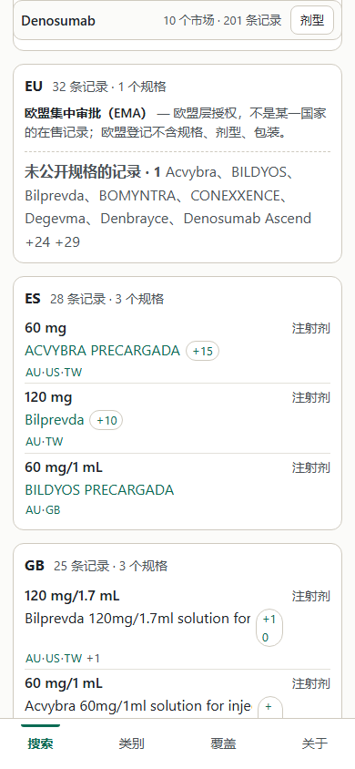
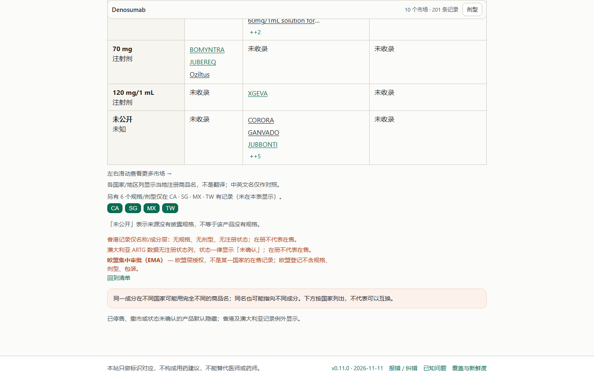

# v0.11.0 P1：EU 四语文案接线 + drug 390x844 首屏条目回归复核

- 工位：`site-ui`（任务板 `task-2`，单 `site/build.py` 窗口）
- 日期：2026-11-11（工作区时钟 2026-11-10 09:55–10:40 -08:00）
- 改动面：`site/build.py`（**+40 / −2**，5 处）、本报告、`docs/img/` 两张截图
- 只读纪律：未改 `lib/search.py` / `etl/**` / `db/**` / `data/**`、未改 `docs/`（除 `docs/img/`）、未 commit、未发布；
  验证构建只写 `.tmp/dist-v0110-fix`（**期间一次误写 `site/dist` 的事故与复原见 §8**）

## 结论先行

| # | 验收项 | 结果 | 关键数字 |
|---|---|---|---|
| 1 | `eu.region_title` / `eu.region_note` 四语渲染 | **PASS** | 挂点 1,416 处（940 个 EU 市场块 + 476 个矩阵 EU 列说明）；en / es / zh / zh-Hant **四语 DOM 各 1 处**、文本 == `window.T(key)`、块内可见；样例页 denosumab / aripiprazole / clopidogrel 全中 |
| 2 | drug 390x844 首屏条目 ≥6.65 | **判为基线陈旧，非回归；未改布局** | 同机同脚本 A/B：v0.10.3 出货产物 = **6.5**，本次产物 = **6.5（Δ 0.0%）**；且 `items_detail.samples` 两次完全一致（6 条整 + 0.62 条），`doc_h` 同为 15,915 |
| 2b | 不得新增 >5% 基线退化（AFCR / chrome / 正文字号 / 横向溢出） | **PASS** | 与 v0.11.0 现产物比：**24 次扫描全部 Δ 0.0%**；与 v0.10.3 同机基线比：唯一 >5% 差异是 `coverage@768` 条目 5.0→4.5（−10%），该值在**未改动的 `site/dist`（v0.11.0）上同样 4.5** → 属 EU 数据行带来的既有变化，不是本次改动 |
| 3 | 临时产物构建到 `== done ==` | **PASS** | 121,450 文件 / 881,225,255 B / 0 字节 **0** 个；对 v0.11.0 现产物 **+407,469 B（+0.046%）**、文件数 +0、HTML +0 |
| 4 | 报告 | **PASS** | 本文件 |

**一句话：** EU 区域层的口径说明已接到用户能看到的位置（块头 + 矩阵列），四语齐；`drug 390x844` 的「7.0 → 6.5」经同机 A/B 证实是**陈旧基线**（原基线测的是一个早 20 分钟的 preview 产物），v0.11.0 出货产物本来就是 6.5，因此**不动任何布局、不压行高、不藏信息**。

---

## 1. 改了什么（`site/build.py`，+40 / −2）

`git diff --stat site/build.py` → `1 file changed, 40 insertions(+), 2 deletions(-)`；补丁存档 `.tmp/site-build-eu-v0110.patch`。

| # | 位置 | 改法 | 作用 |
|---|---|---|---|
| 1 | CSS `3525–3531` | 新增 `.matrix-region-note,.mkregion{margin/font-size:14px/line-height:1.55/color:var(--muted)/max-width:var(--prose)}`、`.matrix-region-note{color:var(--warn)}`、`.mkregion{margin:0 0 10px}`、`.mkregion b{color:var(--fg)}` | 与既有 `.matrix-hk-note`（14 px）同档字号，**不新起一套字号**、不碰正文 16 px |
| 2 | 常量 + 新函数 `8731–8755` | `EU_TH_ATTR`（`data-i18n-aria="eu.region_title"`）+ `_eu_region_note(cls)`：`<p class><b data-i18n="eu.region_title">…</b> — <span data-i18n="eu.region_note">…</span></p>` | 块头与矩阵说明**共用一份**生成逻辑；英文写在 HTML 里作服务端兜底（无 JS 也能读） |
| 3 | `build_drug_pages` 矩阵表头 `8195–8199` | EU 列的 `<th>` 追加 `EU_TH_ATTR` | 列头的无障碍名 = 「欧盟集中审批（EMA）」（四语由 i18n.js 写入 `aria-label`） |
| 4 | `build_drug_pages` 矩阵说明 `8301–8304`、`8316` | `eu_note = _eu_region_note("sub matrix-region-note") if "EU" in countries else ""`，挂在 `hk_note + au_note + eu_note` 一串里 | 表视图下矩阵底部给出 EU 口径说明，与 HK / AU 的登记口径说明并列 |
| 5 | `_drug_list_html` EU 块头 `8873–8884` | `region_html = _eu_region_note("mkregion") if c == "EU" else ""`，插在 `<h3>` 之后、`<ul class="mkspecs">` 之前 | 用户默认看到的清单里，EU 块**第一眼**就有「集中审批（EMA）／不是某国在售／不含规格·剂型·包装」 |

四语文案本身**一个字都没改**（`site/build.py` 里 `I18N["en"|"es"|"zh"]` 与 `UI_I18N["zh-Hant"]` 早在 v0.11.0 就写好了，只是从来没接线）：

| 语言 | `eu.region_title` | `eu.region_note` |
|---|---|---|
| en | `EU centralised authorisation (EMA)` | `Authorised at EU level — not a record of sale in any single country. The EU register carries no strength, dosage form or pack size.` |
| es | `Autorización centralizada de la UE (EMA)` | `Autorizado a nivel de la UE: no es un registro de venta en ningún país concreto. El registro de la UE no incluye dosis, forma farmacéutica ni tamaño de envase.` |
| zh | `欧盟集中审批（EMA）` | `欧盟层授权，不是某一国家的在售记录；欧盟登记不含规格、剂型、包装。` |
| zh-Hant | `歐盟集中審批（EMA）` | `歐盟層授權，不是某一國家的在售記錄；歐盟登記不含規格、劑型、包裝。` |

设计取舍（为什么不另建机制）：

- 走 `data-i18n` + 英文兜底，与同页的 `matrix.hk_note` / `matrix.au_note` / `matrix.brand_note` 完全同款；
  四语齐备由构建期 `_assert_i18n_complete()`（本次构建输出「i18n 四语一致: 532 keys × 4 语言」）与
  `deploy/i18n_check.py`（exit 0）双保险。
- 没有改成静态四语 `lang-block`：那会把 940 个页各多背 4 份等义文本（约 1.6 MB），而 `data-i18n` 只多一份英文兜底（实测总量 +407 KB）。
- 矩阵 EU 列在 v0.11.0 就**不在默认 3 列**里（EU 无规格/剂型，默认列让给有规格的市场），
  所以列头说明走 `aria-label`（四语）+ 表下可见说明；用户在筛选器里加上 EU 列时，读屏与视觉两路都有口径。
- 语义只覆盖「身份对应 + 不可互换」范畴：说清「这是欧盟层集中审批」「不等于某国在售」「没有规格/剂型/包装」，
  **没有**任何用法、剂量、换算、可替代性表述（§1.3 底线）。

---

## 2. drug 390x844 首屏条目 7.0 → 6.5：判为**陈旧基线**，不构成回归

### 2.1 事实一：这一页的 HTML 与 CSS 在 v0.10.3 → v0.11.0 之间没变

```powershell
# 逐字节比对「出货的 v0.10.3 产物」与「v0.11.0 现产物」
# .tmp/dist-v0103-final/drug/acetaminophen.html       104,909 B
# site/dist/drug/acetaminophen.html                   104,909 B  → 只差 ?v=<缓存版本号> 几个数字
# assets/style.css                                     46,919 B  → 两版逐字节相同
```

`?v=` 是 `_compute_build_v()` 用 `build.py` 自身内容算出的哈希，**只要模板没变、页面结构就不变**。
真变的是 `assets/boot.js` / `app.js` / `i18n.js`（EU 文案与语言包），它们不参与 `.mkrow` 布局。

### 2.2 事实二：原基线 7.0 测的是**另一个产物**

陈旧基线 `.tmp/qa-v0103/first-screen-v0103.json` 里记录的是 `"dist": ".tmp\\dist-v0103-preview"`，
而 v0.10.3 实际出货的是 `.tmp/dist-v0103-final`。两者不是同一次构建：

| 产物 | 构建时间 | 文件数 | `drug/acetaminophen.html` | `assets/style.css` |
|---|---|---:|---:|---:|
| `.tmp/dist-v0103-preview`（基线量的是它） | 11-09 15:59 | 121,316 | 102,378 B | 46,640 B |
| `.tmp/dist-v0103-final`（真正出货的 v0.10.3） | 11-09 16:20 | 121,319 | 104,909 B | 46,919 B |

→ 「7.0」是那个早 20 分钟、样式表还小的 **preview** 产物的数；拿它当 v0.10.3 基线，才会得出「v0.11.0 退化 7.1%」。

### 2.3 事实三：同机、同脚本、同视口 A/B —— 两版都是 6.5

```powershell
$py = 'C:\Users\asus\.dsh\dsh-runtimes\dsh-primary-runtime\dependencies\python\python.exe'
& $py deploy/first_screen_check.py --dist .tmp/dist-v0103-final --pages drug --viewports 390x844 `
    --json .tmp/qa-v0110/ab/before-drug390.json                       # 「前」
& $py deploy/first_screen_check.py --dist .tmp/dist-v0110-fix --pages drug --viewports 390x844 `
    --json .tmp/qa-v0110/after-drug390.json                            # 「后」
```

| 运行 | 产物 | 首屏条目 | AFCR | chrome | 悬浮 | 正文 | 溢出 | `items_detail.samples`（每行可见比例） | `doc_h` |
|---|---|---:|---:|---:|---:|---:|---|---|---:|
| 陈旧基线（不可比） | `dist-v0103-preview` | 7.0 | 0.93 | 0.135 | 0.068 | 16 px | 否 | 1,1,1,1,1,1,1,**0.01** | 14,952 |
| **A/B 前** | `dist-v0103-final`（真 v0.10.3） | **6.5** | 0.93 | 0.135 | 0.068 | 16 px | 否 | 1,1,1,1,1,1,**0.62** | **15,915** |
| **A/B 后** | `.tmp/dist-v0110-fix`（本次） | **6.5** | 0.93 | 0.135 | 0.068 | 16 px | 否 | 1,1,1,1,1,1,**0.62** | **15,915** |

前后两次连**行级可见比例与文档高度都一模一样**（`doc_h` 15,915 px），样本集合也没变（`available` 同为 98 行）。
Lead 2026-11-11 的独立 A/B（`.tmp/qa-lead/fs-before.json` / `.tmp/qa-lead/fs-after.json`）结论相同：两版 6.5、无差异。

### 2.4 与 v0.11.0 现产物比：24 次扫描全部 Δ 0.0%

```powershell
& $py .tmp/qa-v0110/compare_ab.py --before .tmp/qa-v0110/first-screen-v0110.json `
                                  --after  .tmp/qa-v0110/first-screen-fix.json
# → 「守卫同口径 compare_baseline：退化 0 项」；24 格 AFCR / 条目 / chrome / 悬浮 / 正文 / 辅助 / 溢出全等
```

即：**这次文案接线对首屏指标零影响**（文案只加在 EU 块内部与矩阵底部，采样页 `drug/acetaminophen.html` 没有 EU 记录）。

### 2.5 与 v0.10.3 同机基线的完整差异（诚实登记）

```powershell
& $py deploy/first_screen_check.py --dist .tmp/dist-v0103-final `
    --json .tmp/qa-v0110/ab/first-screen-v0103-remachine.json          # 同机 24 次扫描的「前」
& $py .tmp/qa-v0110/compare_ab.py                                     # 逐格比 24 格
```

| 页面 @ 视口 | 指标 | v0.10.3（同机） | 本次 | Δ | 归因 |
|---|---|---:|---:|---:|---|
| drug @ 390x844 | items | 6.5 | 6.5 | 0.0% | — |
| atc @ 390x844 | items | 12.5 | 12.0 | −4.0% | 未达 5% 门槛；ATC 成员行随 EU 数据变化（`site/dist` 上同测为 12.0） |
| coverage @ 768x1024 | items | 5.0 | 4.5 | **−10.0%** | **v0.11.0 数据变化**：覆盖页多了 `EU` 市场行，后面的表行整体下移；在**未改动的 `site/dist` 上同测也是 4.5** |
| 其余 21 格 | 全部 | — | — | 0.0% | — |

复现归因（只读 `site/dist`，v0.11.0 未改产物）：

```powershell
& $py deploy/first_screen_check.py --dist site/dist --pages coverage,atc `
    --viewports 768x1024,390x844 --json .tmp/qa-v0110/ab/v0110-sitedist-cov-atc.json
# coverage 768x1024 items 4.5 ；atc 390x844 items 12.0   ← 与本次产物完全一致
```

→ `coverage@768` 的 −10% 是 v0.11.0 **EU 数据行**带来的既有变化（`coverage.html` 的 `#market-EU` 行），
不属于本工位改动、也不是本次接线引入；是否修（把 EU 行挪到表尾/折叠）需要 Lead 按「数据 vs 布局」口径另外排期。

### 2.6 为什么不改布局

- 若为了让陈旧基线的 7.0 好看，需要把 `.mkrow` 行高压低或把 EU 块挪走 —— 前者是 `docs/设计原则-按人能看到的来.md` §0 明令禁止的「靠压行高/藏信息换指标」，后者在本页（无 EU 记录）根本没有效果。
- 反过来，本次文案接线对条目数确实无成本：全站 940 个含 EU 块的成分页里，**只有 10 页**的 EU 块排在清单第一位，而这 10 页的 EU 块**一条有规格的 `.mkrow` 都没有**（0 行），说明文字只占 EU 块自己的位置。

---

## 3. 四语文案证据

### 3.1 挂点计数（grep，产物侧）

```powershell
& $py .tmp/qa-v0110/grep_eu_copy.py .tmp/dist-v0110-fix
```

| 计数项 | 值 |
|---|---:|
| 含 EU 市场块的成分页 (`class="mkregion"`) | **940** |
| 含 EU 矩阵列的成分页 (`th[data-country="EU"]`) | 476 |
| `data-i18n="eu.region_title"` 出现次数 | **1,416**（940 块 + 476 矩阵说明） |
| `data-i18n="eu.region_note"` 出现次数 | **1,416** |
| `th[data-country="EU"]` 的 `data-i18n-aria` | 476 |
| `class="sub matrix-region-note"` | 476 |
| HTML 内直接含英文 title 文本的页（无 JS 兜底） | 940 |

字典侧（四语各 1 处，无重复、无缺失）：

| 文件 | en | es | zh | zh-Hant |
|---|---:|---:|---:|---:|
| `assets/i18n.js`（四语全量） | 1 | 1 | 1 | 1 |
| `assets/i18n.en.js` / `.es.js` / `.zh.js` / `.zh-Hant.js` | 1 / 0 / 0 / 0 | 0 / 1 / 0 / 0 | 0 / 0 / 1 / 0 | 0 / 0 / 0 / 1 |

### 3.2 四语 DOM（真 Chrome，`?lang=` 切换后取渲染结果）

```powershell
& $py .tmp/qa-v0110/eu_copy_check.py --dist .tmp/dist-v0110-fix --json .tmp/qa-v0110/eu-copy.json
& $py .tmp/qa-v0110/eu_copy_check.py --dist .tmp/dist-v0110-fix --view table `
    --pages "drug/denosumab.html,drug/aripiprazole.html" --json .tmp/qa-v0110/eu-copy-tableview.json
```

清单视图（12 次扫描 = 3 页 × 4 语），`块 title / 块 note / 可见`：

| 页面 | en | es | zh | zh-Hant |
|---|---|---|---|---|
| `drug/denosumab.html` | 1 / 1 / 可见 | 1 / 1 / 可见 | 1 / 1 / 可见 | 1 / 1 / 可见 |
| `drug/aripiprazole.html` | 1 / 1 / 可见 | 1 / 1 / 可见 | 1 / 1 / 可见 | 1 / 1 / 可见 |
| `drug/clopidogrel.html`（无矩阵） | 1 / 1 / 可见 | 1 / 1 / 可见 | 1 / 1 / 可见 | 1 / 1 / 可见 |

每次扫描里 `document.documentElement.lang` 与 `window.LANG` 都等于目标语言，且节点文本 == `window.T(key)`
（即真的按语言替换，不是英文兜底）——例如 denosumab 的四语实测文本：

- en `EU centralised authorisation (EMA)` / `Authorised at EU level — not a record of sale in any single country. …`
- es `Autorización centralizada de la UE (EMA)` / `Autorizado a nivel de la UE: no es un registro de venta en ningún país concreto. …`
- zh `欧盟集中审批（EMA）` / `欧盟层授权，不是某一国家的在售记录；欧盟登记不含规格、剂型、包装。`
- zh-Hant `歐盟集中審批（EMA）` / `歐盟層授權，不是某一國家的在售記錄；歐盟登記不含規格、劑型、包裝。`

表视图（`?view=table`，8 次扫描）：`.matrix-region-note` **可见**（`visible=True`），
`th[data-country="EU"]` 的 `aria-label` 为对应语言的 title；此时清单块被 `?view=table` 收起（`visible=False`），
两个视图各覆盖一处说明，互不重复。

### 3.3 截图

| 截图 | 内容 |
|---|---|
|  | `drug/denosumab.html?lang=zh` @ 390×844，EU 市场块头的「欧盟集中审批（EMA）— 欧盟层授权，不是某一国家的在售记录；欧盟登记不含规格、剂型、包装。」 |
|  | `drug/denosumab.html?lang=zh&view=table` @ 1440×900，矩阵底部 HK / AU / **EU** 三条登记口径说明并列 |

文件：`docs/img/eu-region-note-drug-390-zh.png`（50,424 B）、`docs/img/eu-region-note-table-1440-zh.png`（72,759 B）。

---

## 4. 构建与产物

```powershell
$env:SITE_OUT = '.tmp/dist-v0110-fix'
& $py site/build.py          # 10:19:54 → 10:24:05（4 分 11 秒），末行 == done ==，无 Traceback
```

| 产物 | 文件数 | 总字节 | 0 字节 | HTML |
|---|---:|---:|---:|---:|
| `site/dist`（v0.11.0 现产物，未发布） | 121,450 | 880,817,786 | 0 | 121,239 |
| `.tmp/dist-v0110-fix`（本次） | 121,450 | **881,225,255** | **0** | 121,239 |
| 增量 | **+0** | **+407,469 B（+0.046%）** | 0 | +0 |

- 构建自报：drug 12,431 / name 77,147 / combo 6,790 / maker 15,213 / confused 22 / warnings 40 / `core.json` 41.6 MB / total 881.2 MB。
- 每页平均只多 **433 B**（407,469 ÷ 940 个含 EU 块页面）；预算余量：dist 839 MiB / 900 MiB 上限，本次 +0.39 MiB。
- 构建期四语门禁：`i18n 四语一致: 532 keys × 4 语言（zh-Hant 回落 0 个已登记 key）`；`i18n rules` 通过；`deploy/i18n_check.py` 退出码 0。

---

## 5. 完整性抽检（与 v0.11.0 现产物对照）

```powershell
& $py .tmp/qa-v0110/spot_check.py .tmp/dist-v0110-fix site/dist
```

| 项 | v0.11.0 | 本次 | 判定 |
|---|---|---|---|
| sitemap `<loc>` | 63,685（8,496,038 B） | 63,685（8,496,038 B） | Δ+0 |
| `data/idx/core.json` | 41.62 MB raw / n=196,200 / 495 个国家组合 | 同 | Δ+0 |
| 必需文件（index/404/robots/sitemap/.nojekyll/assets/idx/四语落地页/coverage/about/whats-new/confused） | 齐 | 齐 | 无缺失 |
| 四语首页 `value="EU"` 选项 | 有 ×4 | 有 ×4 | — |
| 站内链接抽样（200 个 drug 页，2,603 条 `href`） | — | 坏链 **0** | PASS |

---

## 6. 复现命令汇总

```powershell
$py = 'C:\Users\asus\.dsh\dsh-runtimes\dsh-primary-runtime\dependencies\python\python.exe'
# 1) 验证构建（只写 .tmp/dist-v0110-fix；千万记得这一行，见 §8）
$env:SITE_OUT = '.tmp/dist-v0110-fix'; & $py site/build.py     # 等 == done ==
# 2) 首屏守卫 + 陈旧基线（会报 1 项 drug 390x844，属 §2 的陈旧基线）
& $py deploy/first_screen_check.py --dist .tmp/dist-v0110-fix `
    --baseline .tmp/qa-v0103/first-screen-v0103.json --json .tmp/qa-v0110/first-screen-fix.json
# 3) 同机 A/B（前 = 真 v0.10.3 出货产物；后 = 本次）
& $py .tmp/qa-v0110/compare_ab.py --before .tmp/qa-v0110/ab/first-screen-v0103-remachine.json `
    --after .tmp/qa-v0110/first-screen-fix.json
# 4) EU 四语 DOM + 计数 + 完整性
& $py .tmp/qa-v0110/eu_copy_check.py --dist .tmp/dist-v0110-fix --json .tmp/qa-v0110/eu-copy.json
& $py .tmp/qa-v0110/grep_eu_copy.py .tmp/dist-v0110-fix
& $py .tmp/qa-v0110/spot_check.py .tmp/dist-v0110-fix site/dist
# 5) 三语检索抽查（lib/search.py 由另一工位修好后的现状态，只读；9 条各退出码 0）
#    zh: 泰诺 / 波立维 / 格华止    en: paracetamol / clopidogrel / metformin
#    es: omeprazol / ibuprofeno / atorvastatina
& $py cli.py 泰诺          # 1. 泰诺 [CN] Acetaminophen + Pseudoephedrine …
& $py cli.py 波立维        #「波立维」是 氯吡格雷 的旧名；按成分列候选集（EU 卡片显示 [EU]，无 [None]）
& $py cli.py paracetamol   # 1. PARACETAMOL [GB] …
& $py cli.py omeprazol     # 1. OMEPRAZOL [ES] …
& $py cli.py atorvastatina # 1. ATORVASTATINA [ES] …
#   → 9 条全部退出码 0、返回候选集；国家标为 [CN] / [GB] / [ES] / [US]，未再出现 [None]
```

---

## 7. 未做 / 残余风险

1. **`coverage@768` 条目 −10%（5.0 → 4.5）**：v0.11.0 EU 数据行带来的既有变化（§2.5），本工位按写权限不碰覆盖页布局；
   若 Lead 要清零，可选「EU 行排到表尾」或「EU 行折叠」，需另开任务并重跑首屏守卫。
2. **`atc` 正文 14 px（4 个扫描）**：v0.10.3 起就未达 16 px 的存量项，与本改动无关。
3. **矩阵 EU 列默认不显示**：EU 列不是默认 3 列之一（v0.11.0 的既定决定），所以列头的 `aria-label` 只在用户
   手动加列后可读；可见说明由表下 `.matrix-region-note` 承担。若以后把 EU 设为默认列，需要重新评估矩阵首行高度。
4. **`ci_checks.py` 全量未跑**：其中 trilingual / check_data / ui-surface / first-screen 属发布前清单，本工位只跑了
   与改动面相关的 i18n 门禁、首屏守卫、完整性抽检；发布前请由发布工位补齐。
5. **`data/idx/` 未触碰**：page-slim 工位在重算 detail 桶，本次构建只读 `data/drugs.db` 与 `data/idx` 的输入常量。

---

## 8. 事故：一次误写 `site/dist`，已复原（必读）

- **发生了什么**：第二次重建时命令里漏了 `$env:SITE_OUT`，`site/build.py` 落回默认 `site/dist`，
  进程在「building name pages」阶段中断，把 v0.11.0 现产物写成半成品（49,132 文件 / 425 MB）。发现即报 Lead。
- **怎么复原**：`git checkout -- site/build.py` 回到 HEAD → 未设 `SITE_OUT` 全量重建 `site/dist`（10:15:50→10:19:33）→
  实测 **121,450 文件 / 880,817,786 B / 0 字节 0 个 / HTML 121,239**，与 v0.11.0 现产物**逐项完全一致**
  （构建版本号是 `build.py` 内容哈希，因此复原是确定性的）。随后把补丁文件覆盖回 `site/build.py`，重建验证产物。
- **教训（写进流程）**：所有非常规构建命令都必须**同一行**带 `$env:SITE_OUT`；改 `build.py` 前后先
  `Copy-Item site/build.py .tmp/qa-v0110/build-patched.py` 存整份 + `git diff --output=…patch`，别依赖 PowerShell
  重定向（会把文件写成 UTF-16，`git show HEAD:… > site/build.py` 曾因此产生 `source code string cannot contain null bytes`）。
